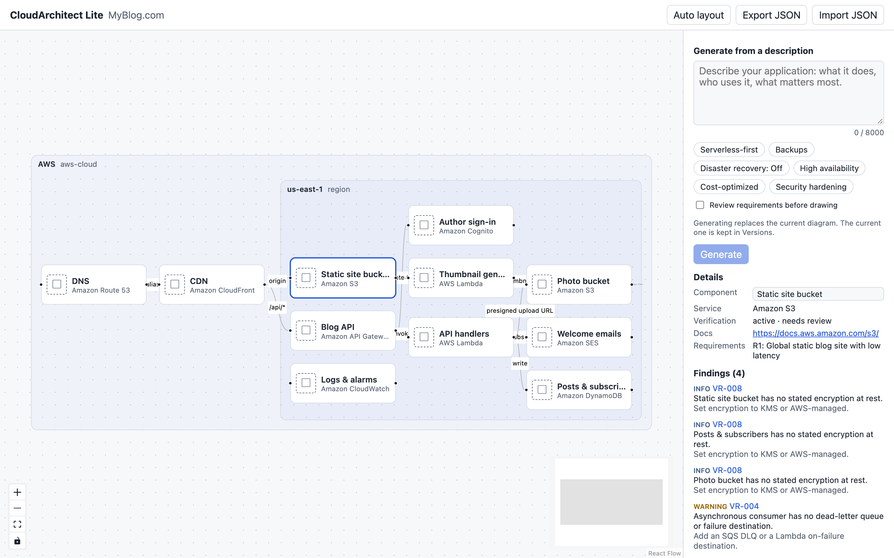

# CloudArchitect Lite

[](https://github.com/aliaksandr-liapin/cloudarchitect-lite/actions/workflows/ci.yml)
[](https://github.com/aliaksandr-liapin/cloudarchitect-lite/actions/workflows/security.yml)
[](LICENSE)


> Describe your application. Get an editable, explainable, validated AWS architecture. Free to start.

Local-first AI cloud architecture designer — AWS first, Azure/GCP ready. The architecture is a typed graph (not an image), validated by deterministic rules and traced back to requirements.

<picture>
  <source media="(prefers-color-scheme: dark)" srcset="docs/images/editor-dark.png">
  
</picture>

**Status:** pre-alpha (ROADMAP Phase 2). AI generation from a description works: describe your app, pick design priorities, answer up to three clarifying questions, and get a validated diagram; earlier diagrams are kept in Versions. The editor, project format, catalog, validation rules, model benchmarks, gateway controls, self-hosted install and CI/CD work too.

## How it works

```mermaid
flowchart LR
  A["Describe your app<br/>(requirements)"] -->|"Claude Haiku or Sonnet<br/>(Phase 2)"| B["Typed architecture graph<br/>services, containers, edges"]
  B --> CValidation rules<br/>VR-001…018
  C -->|findings + fixes| D["Edit on the canvas"]
  D --> C
  D --> E["Export JSON<br/>(diagrams and IaC later)"]
```

1. **Describe** the application in plain language. The AI proposes a design built only from a verified AWS catalog; anything it cannot map is marked as unresolved instead of being made up.
2. **Review** the design on the canvas: every component links to the requirements it serves, its AWS documentation and its verification status.
3. **Validate**: deterministic rules (not the AI) flag problems such as a queue consumer without a dead-letter queue, a WAF on an HTTP API or a single-AZ load balancer, each with a suggested fix.
4. **Edit and export**: move components and auto-layout; the project is saved in your browser and exports as JSON.

## Repository layout

| Path                                                   | What it is                                                                                                                          |
| ------------------------------------------------------ | ----------------------------------------------------------------------------------------------------------------------------------- |
| `apps/web`                                             | React + React Flow editor: nested containers, ELK auto-layout, findings panel, IndexedDB save, JSON import/export                   |
| `apps/gateway`                                         | Hono API gateway for free AI credits: budget cap + kill switch, rate limits, credit ledger (D1). Runs on Cloudflare Workers or Node |
| `packages/domain`                                      | Shared project schema (Zod), graph patches, migrations, validation rule engine                                                      |
| `packages/catalog`                                     | Versioned AWS catalog: services, features, containers, rule metadata, icon-pack records, sample projects                            |
| `eval`                                                 | Benchmark scenarios and the automated evaluation harness (release gate)                                                             |
| `infra/docker`                                         | Container images for web (nginx, non-root) and gateway (Node, non-root)                                                             |
| `docs/product`                                         | PRD, technical architecture, catalog spec, roadmap                                                                                  |
| `docs/adr`                                             | Architecture decision records                                                                                                       |
| `docs/security`, `docs/operations`, `docs/engineering` | Threat model, deployment, scalability, observability, runbook, development and testing guides                                       |

## Install and run (Windows, macOS, Linux)

Only Docker is required. Full guide: [docs/operations/installation.md](docs/operations/installation.md).

```bash
git clone https://github.com/aliaksandr-liapin/cloudarchitect-lite.git
cd cloudarchitect-lite
docker compose up --build
```

Open the setup link printed in the terminal (`http://localhost:8080/setup?code=…`). A [five-step wizard](docs/operations/installation.md#4-finish-setup-in-the-browser) checks your Anthropic API key, lets you choose Claude Haiku 5.5 and/or Sonnet 5.5 based on measured quality and cost, and sets budget limits. Then use the editor at <http://localhost:8080>.

| Model             | Blind review score (0–3) | Checks passed | Cost per generation | Typical wait |
| ----------------- | ------------------------ | ------------- | ------------------- | ------------ |
| Claude Haiku 5.5  | 2.29                     | 96%           | $0.006              | 44 s         |
| Claude Sonnet 5.5 | 2.86                     | 93%           | $0.080              | 51 s         |

Measured on 15 benchmark scenarios × 3, scored by the automated eval harness and a blind rubric review by isolated Claude reviewer sessions; see [phase0-spike.md](docs/product/phase0-spike.md).

## Development

Requirements: Node 26+ (see `.nvmrc`), pnpm 10.32 (`npm install -g pnpm@10.32.1`; Node 25+ no longer bundles corepack).

```bash
pnpm install
pnpm dev                        # web on :5173 (proxies /api), gateway on :8787; setup link in the gateway log
```

## Quality gates

```bash
pnpm run ci     # lint, format check, typecheck, unit tests, build
pnpm eval       # evaluation harness against eval/scenarios
```

CI runs the same checks plus container builds with vulnerability scanning, CodeQL, dependency review, `pnpm audit` and secret scanning. See [docs/engineering/development.md](docs/engineering/development.md).

## Documentation

- Product: [overview](docs/product/README.md) · [PRD](docs/product/prd.md) · [technical architecture](docs/product/technical-architecture.md) · [catalog](docs/product/cloud-provider-catalog.md) · [roadmap](docs/product/roadmap.md)
- Decisions: [docs/adr](docs/adr/)
- Security: [SECURITY.md](SECURITY.md) · [threat model](docs/security/threat-model.md)
- Operations: [deployment](docs/operations/deployment.md) · [scalability](docs/operations/scalability.md) · [observability](docs/operations/observability.md) · [runbook](docs/operations/runbook.md)

## Contributing and support

See [CONTRIBUTING.md](CONTRIBUTING.md), [SUPPORT.md](SUPPORT.md) and the [code of conduct](CODE_OF_CONDUCT.md). Changes are listed in [CHANGELOG.md](CHANGELOG.md).

## License

[Apache License 2.0](LICENSE). Cloud provider names, icons and trademarks belong to their owners and are not included in this repository; see [NOTICE](NOTICE) and [the catalog spec](docs/product/cloud-provider-catalog.md#2-sources-of-truth). This project is not affiliated with or endorsed by any cloud provider.
