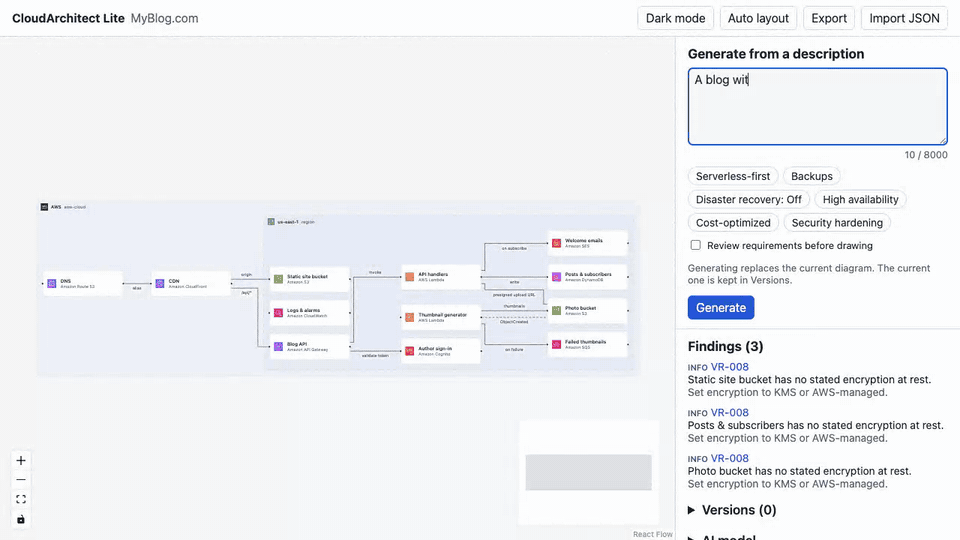

# CloudArchitect Lite

[](https://github.com/aliaksandr-liapin/cloudarchitect-lite/actions/workflows/ci.yml)
[](https://github.com/aliaksandr-liapin/cloudarchitect-lite/actions/workflows/security.yml)
[](LICENSE)


> Describe your app in plain English and get an AWS architecture, checked against 25 rules, running on your own machine with your own key.



_Replay of a real recorded generation with Claude Haiku, shortened: a real generation takes about 50 seconds._

**[Try the demo](https://aliaksandr-liapin.github.io/cloudarchitect-lite/)** (a clickable editor in your browser, no install) · **[Install](#install)** (one command, needs Docker)

## Install

You need [Docker](https://docs.docker.com/get-docker/) and an [Anthropic API key](https://console.anthropic.com/). Then run one command.

macOS and Linux:

```bash
curl -fsSLO https://raw.githubusercontent.com/aliaksandr-liapin/cloudarchitect-lite/v0.2.1/compose.yaml && docker compose up
```

Windows (PowerShell):

```powershell
curl.exe -fsSLO https://raw.githubusercontent.com/aliaksandr-liapin/cloudarchitect-lite/v0.2.1/compose.yaml; docker compose up
```

Open the setup link printed in the terminal. A short wizard checks your key, lets you pick a model and sets your daily and monthly spending limits. Then the editor is at <http://localhost:8080>.

Details, upgrading and troubleshooting: [installation guide](docs/operations/installation.md). To build from source, see [development guide](docs/engineering/development.md).

**About the AWS icons.** On first start, CloudArchitect Lite downloads the official AWS icon set from aws.amazon.com, so the internet is needed for that step (offline installs work with generic tiles). AWS terms allow the icons for creating architecture diagrams but do not cover redistribution, which is why they are not in this repository or its images. Each release uses the newest AWS icon set the project has verified, pinned by hash, so every install looks the same.

**Privacy.** Your keys and projects stay on your machine; prompts go only to your AI provider.

## How it works

1. **Describe** your application in plain language. The AI asks up to three clarifying questions.
2. **Generate** a design built only from a curated catalog of 38 AWS services, placed in containers (cloud, region, VPC, availability zone, subnet). A service the catalog does not know is flagged as unresolved instead of invented.
3. **Validate**: 25 deterministic rules (VR-001 to VR-025, not the AI) check the design and report findings, for example a queue consumer without a dead-letter queue or a single-AZ load balancer.
4. **Edit and export** on the canvas, then export JSON, PNG or SVG.

## What works today

- Plain-English description, clarifying questions and design-priority toggles (serverless-first, backups, disaster recovery, high availability, cost-optimized, security hardening).
- AWS diagrams with official icons, containers and 25 validation rules with findings.
- Editor: drag, resize, auto layout, light and dark theme, and versions that keep earlier diagrams.
- Import and export JSON; export PNG and SVG.
- Self-hosted with Docker on your own Anthropic key, with daily and monthly spending limits.
- Choice of Claude Haiku 5.5 or Claude Sonnet 5.5. In the Gate A live runs, Haiku cost about $0.007 per generation and Sonnet about $0.045, and both passed the automated checks on 93% of runs. On the same nine base scenarios, blind reviewers scored Haiku 2.00 and Sonnet 2.57 out of 3. Method and caveats: [Gate A report](docs/product/phase2-gate-a.md).

## What's next

0.3 compares Claude, GPT and Gemini with a public benchmark. 0.4 adds Review (an AI critique of any diagram) and Mermaid export. See the [roadmap](docs/product/roadmap.md#2-public-release-roadmap-from-2026-10-26).

## Documentation

- Product: [overview](docs/product/README.md) · [PRD](docs/product/prd.md) · [technical architecture](docs/product/technical-architecture.md) · [catalog](docs/product/cloud-provider-catalog.md) · [roadmap](docs/product/roadmap.md)
- Decisions: [docs/adr](docs/adr/)
- Security: [SECURITY.md](SECURITY.md) · [threat model](docs/security/threat-model.md)
- Operations: [installation](docs/operations/installation.md) · [deployment](docs/operations/deployment.md) · [runbook](docs/operations/runbook.md)
- Engineering: [development](docs/engineering/development.md) · [testing](docs/engineering/testing.md)

## Contributing and support

See [CONTRIBUTING.md](CONTRIBUTING.md), [SUPPORT.md](SUPPORT.md) and the [code of conduct](CODE_OF_CONDUCT.md). Changes are listed in [CHANGELOG.md](CHANGELOG.md). Report vulnerabilities as described in [SECURITY.md](SECURITY.md).

## License

[Apache License 2.0](LICENSE). Cloud provider names, icons and trademarks belong to their owners and are not included in this repository; see [NOTICE](NOTICE). This project is not affiliated with or endorsed by any cloud provider.
