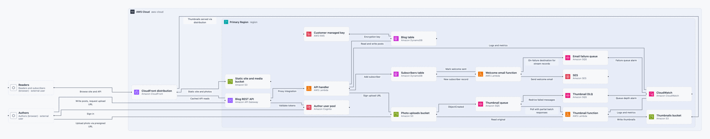

# Serverless Global Blog

A read-heavy serverless blog: a static site and a REST API behind a CDN, welcome emails, and photo thumbnails.

_19 components, 26 connectors, 2 containers. [Open the full-size image](images/myblog.png) or import [myblog.json](myblog.json) into the [demo](https://aliaksandr-liapin.github.io/cloudarchitect-lite/) with **Import JSON**._

## The description

> We need a serverless global blog. Traffic is read-heavy with infrequent writes. Static site plus a REST API, with caching. New subscribers get a welcome email. Authors upload photos and we need thumbnails. Keep latency and cost low.

No design priorities were selected.

## Questions the AI asked

Each was answered **You decide**, so the AI chose for you.

- How should authors sign in to write posts and upload photos?
- What read traffic and author count should the design handle at peak?
- What should the welcome email include and how should subscribers be confirmed?

## Requirements

From the description (9):

- Serverless global blog
- Traffic is read-heavy with infrequent writes
- Serve a static site plus a REST API
- Use caching to reduce read latency and load
- Send a welcome email to new subscribers
- Authors can upload photos
- Generate thumbnails for uploaded photos
- Serve content globally with low latency
- Keep cost low

Added by the AI, marked as inferred for you to review (8):

- Scale automatically with traffic without managing servers
- Serve cached reads to global readers with minimal origin load
- Process photo uploads asynchronously so authors are not blocked on thumbnail generation
- Protect write endpoints and author uploads from unauthenticated access
- Store blog posts and subscriber records in a serverless database
- Failed asynchronous processing (thumbnails, emails) must be retained and alarmed on
- Monitor the system with logs, metrics and alarms
- Data stores are encrypted at rest and DynamoDB has point-in-time recovery

## Findings

1 from the 26 rules ([what they check](../manual/05-findings.md#the-rules)):

- **warning** VR-012: Requirement C-user-scale is not covered by any component or connection.

_The VR-012 warnings come from the questions answered **You decide**: each question is kept as a requirement, and no component is linked to it yet. Linking one in [Details](../manual/04-edit-by-hand.md#details-and-settings) clears the warning._

## How it was made

Claude Sonnet 5.5, CloudArchitect Lite 0.4 (development build, 26 November 2026). Generation took 34 s and cost $0.051; the repair turn was not needed. The design is exactly as generated: nothing was edited by hand.

[← All examples](README.md)
