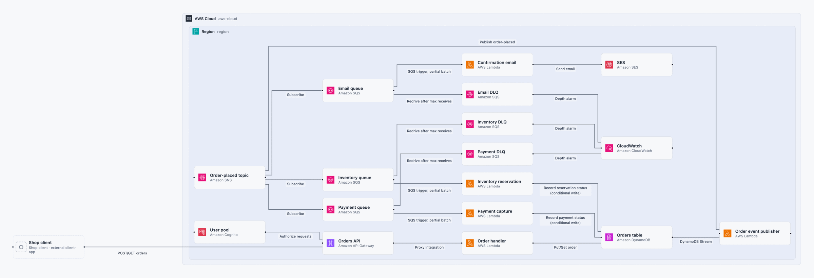

# Online Shop Order Processing

Event-driven order processing: payment, inventory and email each run on their own, with retries and dead-letter queues.

_18 components, 21 connectors, 2 containers. [Open the full-size image](images/order-events.png) or import [order-events.json](order-events.json) into the [demo](https://aliaksandr-liapin.github.io/cloudarchitect-lite/) with **Import JSON**._

## The description

> An online shop accepts orders through an API. After an order is placed, payment capture, inventory reservation and the confirmation email must happen independently, so a failure in one does not block the others. Failed steps must be retried and never silently lost. Orders are looked up by order ID.

No design priorities were selected.

## Questions the AI asked

None: the description was specific enough to draw from directly.

## Requirements

From the description (6):

- Accept orders through an API
- After an order is placed, payment capture, inventory reservation and confirmation email must happen independently
- A failure in one step (payment capture, inventory reservation, confirmation email) must not block the others
- Failed steps must be retried
- Failed steps must never be silently lost
- Orders can be looked up by order ID

Added by the AI, marked as inferred for you to review (7):

- Order processing steps are decoupled so each can fail and recover independently
- Retries that exhaust attempts must be captured for inspection and reprocessing (dead-letter handling)
- Order placement should return an acknowledgement without waiting for all downstream steps to complete
- Order creation must be authenticated/authorized and the order write plus event publish must not lose events
- Alarm on dead-letter queue depth and monitor processing
- Consumers must be idempotent since queues deliver at least once
- Order data encrypted at rest and backed up

## Findings

None: all 26 rules pass.

## How it was made

Claude Sonnet 5.5, CloudArchitect Lite 0.4 (development build, 26 November 2026). Generation took 29 s and cost $0.063; the repair turn was not needed. The design is exactly as generated: nothing was edited by hand.

[← All examples](README.md)
