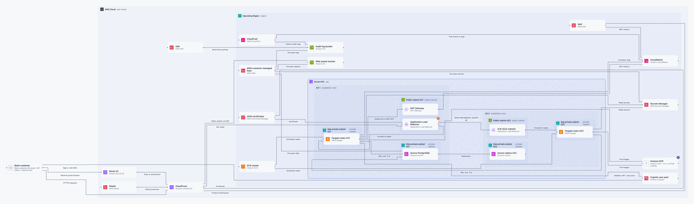

# Regional Bank Customer Self-Service Portal

A bank portal with strict security: WAF and DDoS protection, customer-managed encryption keys, an audit trail and MFA, with containers in private subnets across two Availability Zones.

_23 components, 34 connectors, 11 containers. [Open the full-size image](images/regulated-portal.png) or import [regulated-portal.json](regulated-portal.json) into the [demo](https://aliaksandr-liapin.github.io/cloudarchitect-lite/) with **Import JSON**._

## The description

> A regional bank needs a customer self-service portal (web app plus API). Requirements: protection against common web exploits and DDoS, TLS everywhere, all data encrypted at rest with keys we control, a full audit trail of administrative API activity in the AWS account, and customer sign-in with MFA. The app tier runs in containers in private subnets.

No design priorities were selected.

## Questions the AI asked

Each was answered **You decide**, so the AI chose for you.

- Which regulatory frameworks must the portal satisfy, since this changes logging, retention, and encryption controls?
- Which MFA methods should customers use to sign in?
- What availability target should the portal meet?

## Requirements

From the description (7):

- Protection against common web exploits and DDoS
- TLS everywhere
- All data encrypted at rest with keys the customer controls
- Full audit trail of administrative API activity in the AWS account
- Customer sign-in with MFA
- Customer self-service web application plus API
- Application tier runs in containers in private subnets

Added by the AI, marked as inferred for you to review (10):

- Regional bank scope: workloads and data remain within the bank's operating region
- Audit logs are retained and protected from tampering
- Encryption keys are customer-managed with rotation and access logging
- Network ingress limited to HTTPS through managed edge and load balancing; no direct public access to private containers
- Secure customer identity with MFA enforced for all customer sign-ins
- Highly available application tier and database across two Availability Zones
- Persistent store for customer portal data, encrypted with customer managed keys and backed up
- Application secrets and configuration held in a managed secrets store, not in container images
- Monitoring and alarms on application, WAF and audit-log health
- Private containers need outbound access to AWS APIs and image pulls without public exposure

## Findings

5 from the 26 rules ([what they check](../manual/05-findings.md#the-rules)):

- **warning** VR-003: Application Load Balancer is reachable from the internet without a stated authentication mechanism. Add a Cognito, IAM or Lambda authorizer (or Cognito/OIDC authentication on the ALB).
- **warning** VR-012: Requirement C-compliance is not covered by any component or connection.
- **warning** VR-012: Requirement C-auth-methods is not covered by any component or connection.
- **warning** VR-012: Requirement C-availability-target is not covered by any component or connection.
- **info** VR-015: Amazon ECR is not in the verified catalog. Replace it with a catalog service or keep it as an explicitly unverified component.

_The VR-012 warnings come from the questions answered **You decide**: each question is kept as a requirement, and no component is linked to it yet. Linking one in [Details](../manual/04-edit-by-hand.md#details-and-settings) clears the warning._

## How it was made

Claude Sonnet 5.5, CloudArchitect Lite 0.4 (development build, 26 November 2026). Generation took 42 s and cost $0.086; the repair turn was not needed. The design is exactly as generated: nothing was edited by hand.

[← All examples](README.md)
