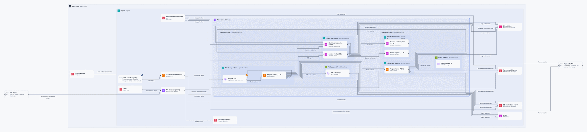

# B2B SaaS REST API on AWS

A containerised B2B API on Fargate that survives the loss of an Availability Zone, with PostgreSQL, a session cache and rotated database credentials.

_22 components, 35 connectors, 11 containers. [Open the full-size image](images/saas-containers.png) or import [saas-containers.json](saas-containers.json) into the [demo](https://aliaksandr-liapin.github.io/cloudarchitect-lite/) with **Import JSON**._

## The description

> We run a B2B SaaS REST API packaged as Docker containers. It needs a PostgreSQL database, a shared session cache, and must survive the loss of one availability zone. The containers must not be reachable from the internet directly, but they call a third-party payments API. Database credentials must be rotated automatically. We do not want to manage Kubernetes or servers.

No design priorities were selected.

## Questions the AI asked

Each was answered **You decide**, so the AI chose for you.

- How do API clients and your users authenticate to the REST API?
- What is the expected scale in tenants, users, and requests per second at launch and in 12 months?
- What availability target and recovery objectives (RTO/RPO) apply beyond surviving one AZ loss?

## Requirements

From the description (8):

- Run a B2B SaaS REST API packaged as Docker containers
- Provide a PostgreSQL database for the API
- Provide a shared session cache
- Containers call a third-party payments API over outbound connectivity
- Survive the loss of one availability zone (multi-AZ resilience)
- Containers must not be directly reachable from the internet
- Database credentials must be rotated automatically
- No Kubernetes and no server management; use serverless or managed container hosting

Added by the AI, marked as inferred for you to review (9):

- Public entry point for API clients must route to private containers through a controlled ingress layer
- Store and manage the payments API credentials securely
- Container images stored in a private registry with scanning and access control
- Centralized logging, metrics, and tracing for the API and data tier
- Tenant isolation appropriate for a B2B SaaS platform
- Encrypt data at rest with customer managed keys and TLS in transit for public traffic
- Authenticate API clients and users with OAuth2 bearer tokens carrying a tenant claim, validated before requests reach the containers
- Protect the public entry point against common web exploits and DDoS
- Backups of the database with point-in-time restore

## Findings

5 from the 26 rules ([what they check](../manual/05-findings.md#the-rules)):

- **warning** VR-012: Requirement C-auth-methods is not covered by any component or connection.
- **warning** VR-012: Requirement C-user-scale is not covered by any component or connection.
- **warning** VR-012: Requirement C-availability-target is not covered by any component or connection.
- **info** VR-015: Amazon Elastic Container Registry (ECR) is not in the verified catalog. Replace it with a catalog service or keep it as an explicitly unverified component.
- **warning** VR-018: The Application Load Balancer is placed in a single Availability Zone. An ALB needs subnets in at least two Availability Zones; place it across both.

_The VR-012 warnings come from the questions answered **You decide**: each question is kept as a requirement, and no component is linked to it yet. Linking one in [Details](../manual/04-edit-by-hand.md#details-and-settings) clears the warning._

## How it was made

Claude Sonnet 5.5, CloudArchitect Lite 0.4 (development build, 26 November 2026). Generation took 41 s and cost $0.066; the repair turn was not needed. The design is exactly as generated: nothing was edited by hand.

[← All examples](README.md)
