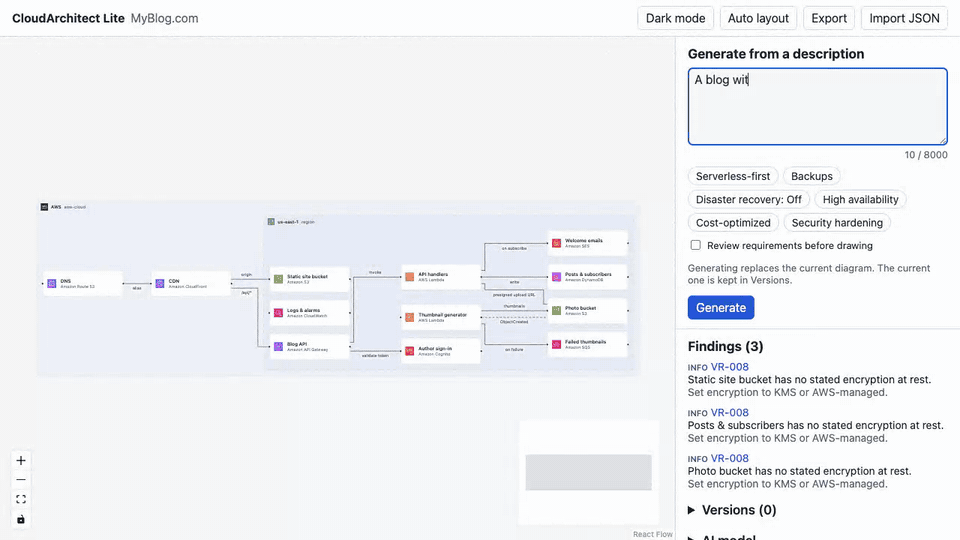

Ask a language model for an AWS architecture and you get a confident answer. Sometimes it includes a service that does not exist, a feature that is not real, or a database floating outside any VPC. A diagram makes this worse, because a clean picture looks more trustworthy than the text it came from.

I built [CloudArchitect Lite](https://github.com/aliaksandr-liapin/cloudarchitect-lite) to turn a plain-English description into an AWS diagram. This post is about the three mechanisms that keep the model honest, and what the numbers look like. Version 0.2 is pre-alpha, and I will say where the evidence is thin.



You can try a clickable editor in the browser without installing anything: <https://aliaksandr-liapin.github.io/cloudarchitect-lite/>.

## 1. The model can only pick from a catalog

The app has a curated catalog of 38 AWS services. Each entry has an id, an icon mapping and the configuration keys that make sense for that service.

The model does not write free-form JSON. It generates against a structured-output schema, and the schema is built from the catalog. The `serviceId` field is an enum of catalog ids, and configuration keys are an enum of catalog-defined feature keys. Constrained decoding means the model cannot emit a service id that is not in the list.

This was not free. My first version used the SDK helper that turns a schema into an output format, and it moved every `enum` into the field description. The decoder was no longer constrained, and Haiku emitted configuration keys outside the catalog in 2 runs. The fix was to build the JSON schema myself so the enums stay real enums. A unit test now checks that the enums are present in the schema.

## 2. If it is not in the catalog, it says so

A closed list has a cost: sometimes the user needs something the catalog does not have. The schema has an escape hatch. A node has either a catalog `serviceId` or an `unresolved` object with a name and a rationale:

```json
{
  "id": "ext-1",
  "provider": "aws",
  "unresolved": {
    "name": "Amazon Rekognition",
    "rationale": "Photo moderation requirement"
  }
}
```

An unresolved node is drawn as a visibly generic tile, and it is never shown as a verified AWS service. A rule (VR-015) reports it as a finding. The point is that "I do not know this one" becomes an explicit, visible state rather than a quiet guess.

## 3. Twenty-five rules the AI does not control

After generation, a deterministic rule set (VR-001 to VR-025) checks the design. These are plain functions over the graph, each with positive and negative test fixtures. Examples:

- An asynchronous consumer, such as SQS to Lambda, without a dead-letter queue or failure destination.
- An Application Load Balancer in a single Availability Zone.
- RDS, Aurora, ElastiCache, EC2 or EFS outside a VPC container.
- A database in a public subnet.
- AWS WAF attached to an API Gateway HTTP API (WAF supports REST APIs only).
- A requirement that no node satisfies, or a node that no requirement asked for.

Because the rules are code, the model cannot talk its way past them. Findings show on the canvas. For the Haiku model, they also feed one repair turn: the generator sends the findings back, naming the offending node or edge ids, and asks for a corrected design.

Two things I learned the hard way here. First, a repair message that only names the rule does not work; naming the node ids and the remediation does. Second, I had made `containerId` optional in the output schema, and the model skipped it on 18 of 59 designs. Databases then sat outside any VPC and the VPC rule fired. Making the field required (nullable for external nodes) fixed it.

## What the numbers say

I ran the shipped generator against 22 scenarios (15 base and 7 that turn on a design-priority toggle such as backups or security hardening). Full method and caveats are in the [Gate A report](https://github.com/aliaksandr-liapin/cloudarchitect-lite/blob/main/docs/product/phase2-gate-a.md).

| Model             | Runs                | Schema-valid | Automated checks passed | Mean cost per generation |
| ----------------- | ------------------- | ------------ | ----------------------- | ------------------------ |
| Claude Haiku 5.5  | 44                  | 100%         | 93.2% (41 of 44)        | about $0.007             |
| Claude Sonnet 5.5 | 15 (base scenarios) | 100%         | 93.3% (14 of 15)        | about $0.045             |

"Automated checks" means required services are present and there are no error-level rule findings. The three Haiku misses were missing services, not rule violations.

For quality I used blind review: four isolated Claude reviewer sessions scored anonymised designs against a rubric from 0 to 3. On the same nine base scenarios, Haiku scored a median of 2.00 and Sonnet 2.57. Sonnet was preferred in 7 of 9 pairs. Across 12 scenarios, Haiku had no critical defect in 11.

Read those numbers with care:

- The reviewers are Claude models reviewing Claude output, so they may share blind spots. This is not a human panel.
- The review packets came from before the container and enum fixes above, so the diagrams were worse than what ships now. I did not re-review the shipped generator.
- One reviewed design per variant per scenario, and the 11 of 12 figure is a margin of a single design.
- Some numbers got worse compared with my earlier spike, and I recorded that in the report instead of hiding it.

## Run it yourself

You need Docker and your own Anthropic API key. Your keys and projects stay on your machine, and prompts go only to Anthropic.

```bash
curl -fsSLO https://raw.githubusercontent.com/aliaksandr-liapin/cloudarchitect-lite/v0.2.0/compose.yaml && docker compose up
```

A short setup wizard checks the key, lets you choose Haiku or Sonnet and sets daily and monthly spending limits. On Windows, use PowerShell with `curl.exe` as shown in the README. I have tested macOS on Apple Silicon and Linux in CI; Windows is covered by the README but has had less testing.

Next up is a public benchmark that compares Claude, GPT and Gemini on the same scenarios. If you try it and get an architecture that is wrong, please open an issue with the prompt. Those cases are the most useful thing I can get right now.

Repository: <https://github.com/aliaksandr-liapin/cloudarchitect-lite>
