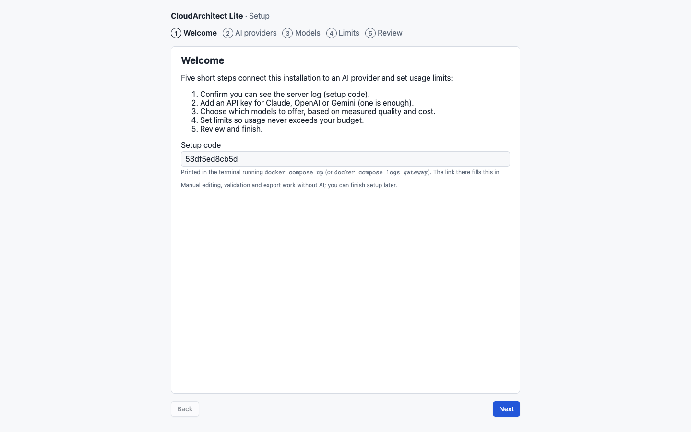
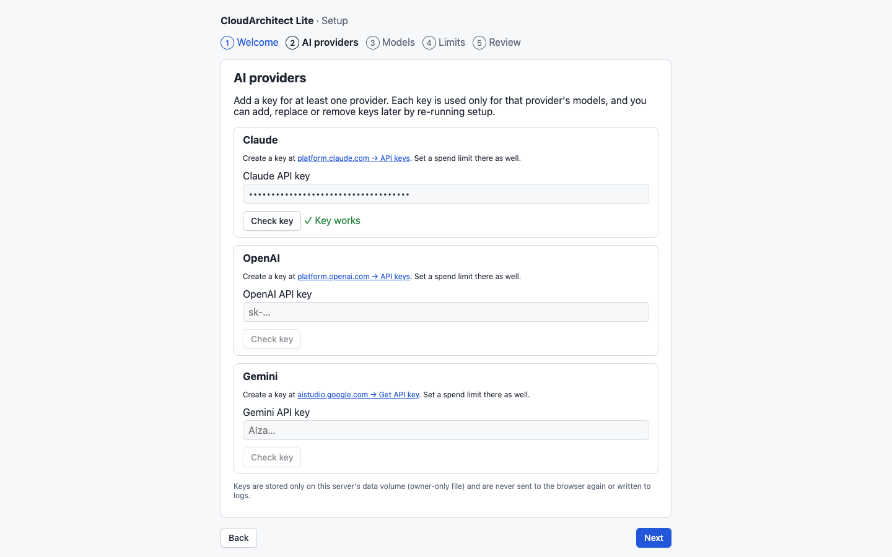
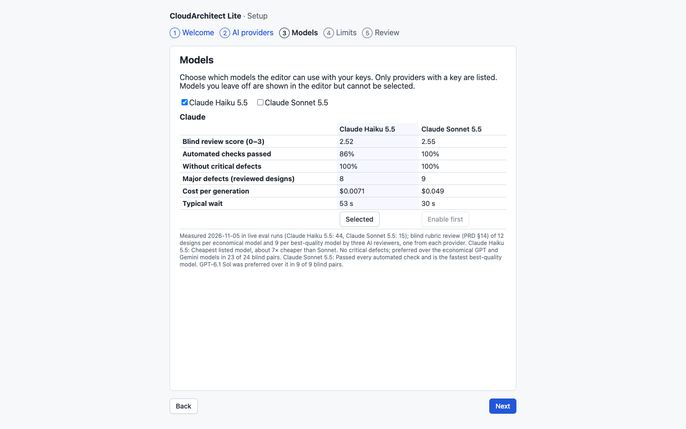
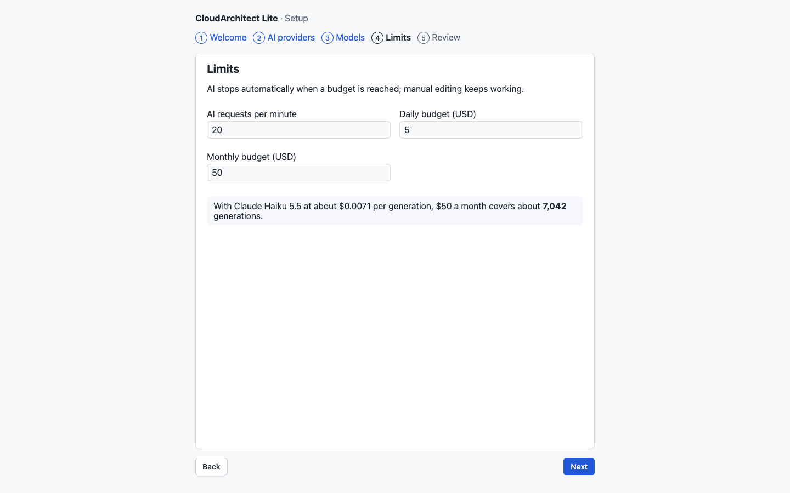
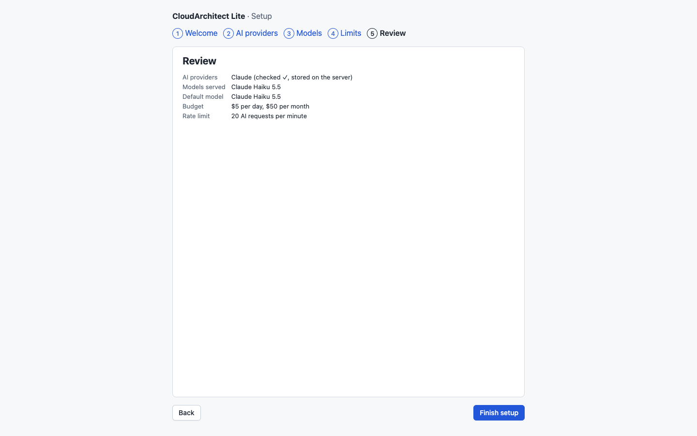
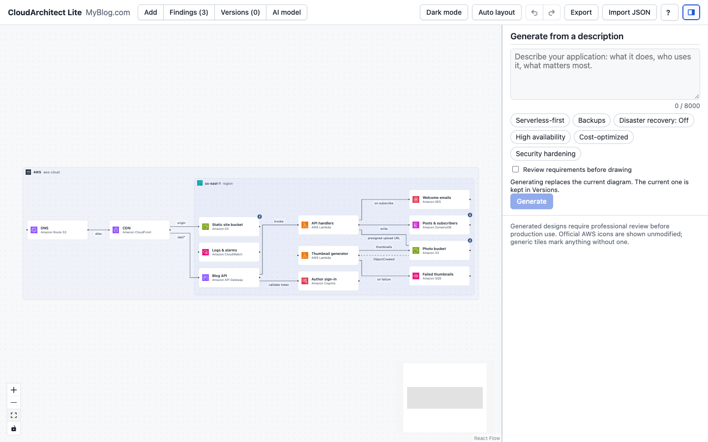

# Install and set up

You need [Docker](https://docs.docker.com/get-docker/) and an API key from at least one AI provider:
[Anthropic (Claude)](https://platform.claude.com/settings/keys),
[OpenAI (GPT)](https://platform.openai.com/api-keys) or
[Google AI Studio (Gemini)](https://aistudio.google.com/apikey). Editing, checking and exporting work
without a key; only generation needs one.

## Install

Run one command in an empty folder:

```bash
# macOS and Linux
curl -fsSLO https://raw.githubusercontent.com/aliaksandr-liapin/cloudarchitect-lite/v0.3.1/compose.yaml && docker compose up
```

```powershell
# Windows (PowerShell)
curl.exe -fsSLO https://raw.githubusercontent.com/aliaksandr-liapin/cloudarchitect-lite/v0.3.1/compose.yaml; docker compose up
```

When it is ready, the terminal prints a setup link such as
`http://localhost:8080/setup?code=1a2b3c4d5e6f`. Open it.

On first start the app downloads the official AWS icons from aws.amazon.com (they may not be
redistributed, so they are not in the images). Without internet you get generic tiles instead.

Upgrading, proxies and troubleshooting: [installation guide](../operations/installation.md).

## The setup wizard

**1. Welcome.** The code in the link proves you can see the server log.



**2. AI providers.** Paste at least one key and press **Check key**. The provider confirms the key
before you can go on. A key set in a `.env` file is shown as set and cannot be changed here.



**3. Models.** Choose which models the editor may use, and the default. The table shows each
model's measured quality, cost and wait. A model is offered only when its provider has a key.



**4. Limits.** Requests per minute and daily and monthly spending limits (defaults: 20 per minute,
$5 a day, $50 a month). When a limit is reached, AI stops; editing keeps working.



**5. Review.** Check the summary and press **Finish setup**, then **Open the editor**.



The editor opens with a sample design, so you can try everything right away.



To change keys, models or limits later, re-run setup: see
[Re-running setup](../operations/installation.md#re-running-setup).
