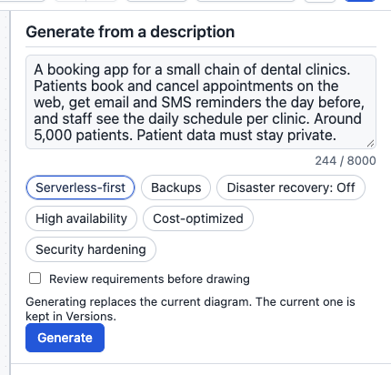
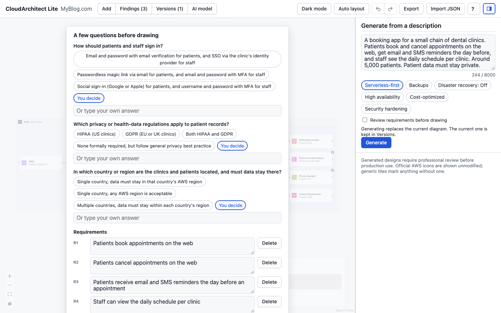
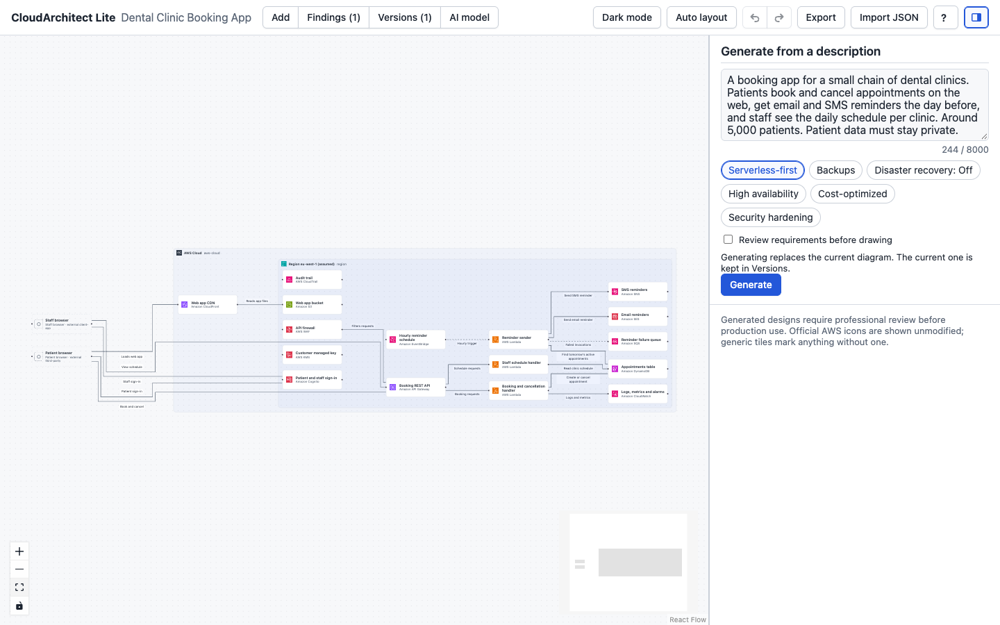

# Generate a design

Generation lives at the top of the side panel, in **Generate from a description**.

1. **Describe your application** in plain language (up to 8,000 characters): what it does, who
   uses it, how much traffic you expect and what matters most.
2. **Design priorities** (optional). Each one you switch on becomes a requirement the design must
   meet, and turns on the rules that check it ([Findings](05-findings.md)):
   - **Serverless-first:** managed and serverless services over servers.
   - **Backups:** every data store has backups or point-in-time recovery; S3 uses versioning.
   - **Disaster recovery:** click to cycle Off → Multi-AZ → Cross-region.
   - **High availability:** no single point of failure, spread across two Availability Zones.
   - **Cost-optimized:** the cheapest reasonable options, scaling to zero where possible.
   - **Security hardening:** WAF on public entry points, KMS encryption, private subnets for data,
     authentication on every public interface.
3. **Review requirements before drawing** (optional): the AI's list of requirements is shown for
   you to edit before it draws.
4. Press **Generate**.

## Clarifying questions

When the description leaves something open, the AI asks up to three short questions. Pick an
answer, type your own, or choose **You decide**. You can also edit the list of requirements here.
Press **Continue** to draw.

## The result

The design appears after about 30 to 65 seconds, depending on the model. A progress line shows
each step, and **Cancel** stops it.

- It uses only services from a curated catalog of 38 AWS services, placed in containers (cloud,
  region, VPC, Availability Zone, subnet). A service the catalog does not know is shown as
  _unresolved_ (a **?** tile) instead of being invented.
- The 26 rules check it at once: see [Findings](05-findings.md).
- Generating replaces the current diagram, but the old one is kept in
  [Versions](06-versions-import-export.md). The notice after a generation also offers
  **Restore previous**.

Generated designs are a starting point. They need professional review before production use.
