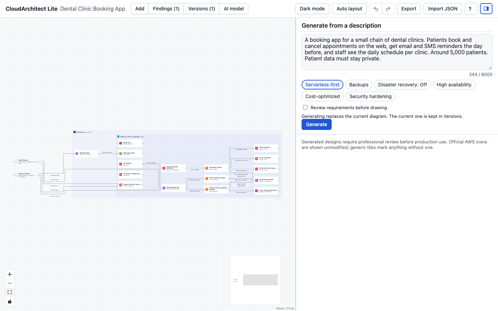
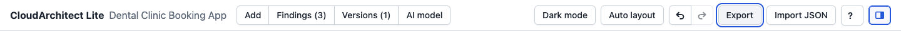
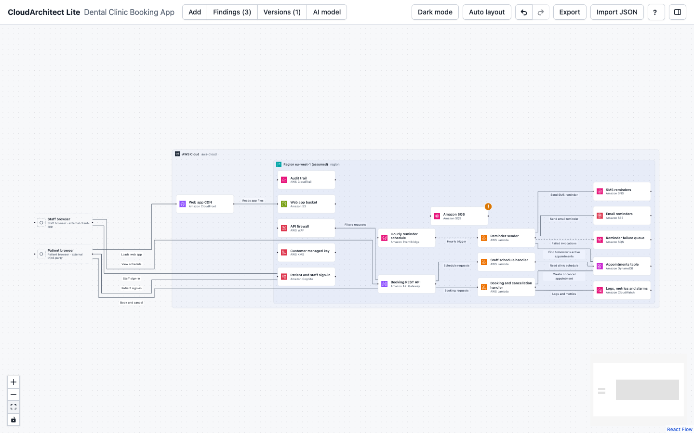
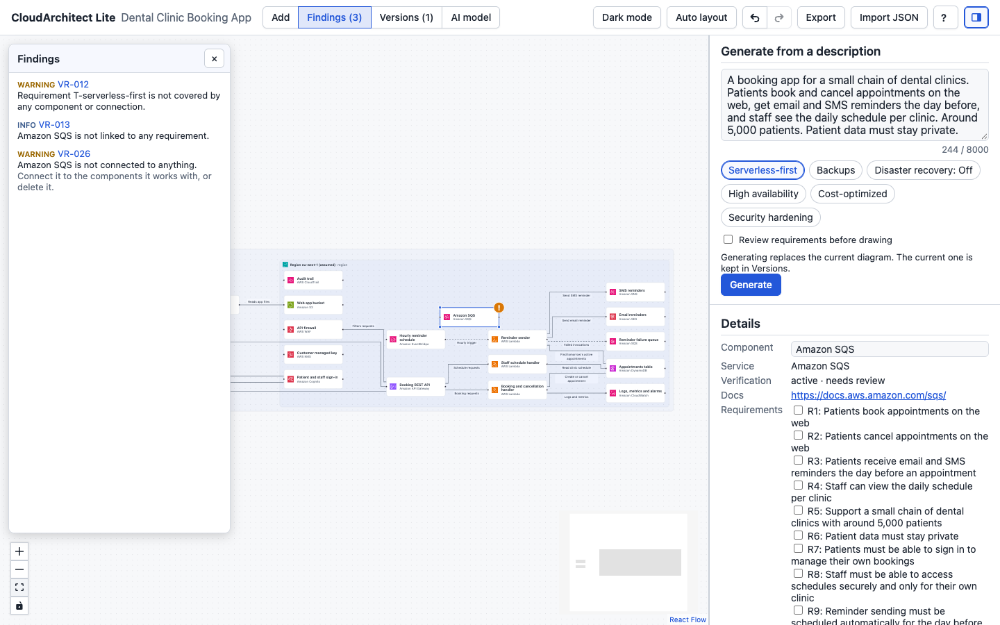
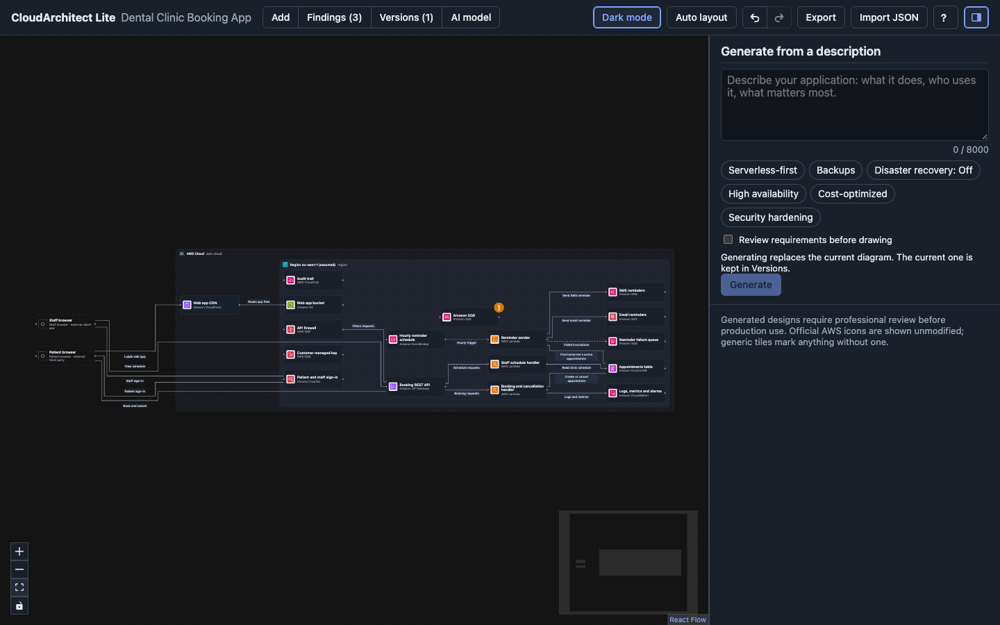

# The editor

## Toolbar

- **Project name** on the left.
- **Add · Findings (n) · Versions (n) · AI model** open and close the [tool windows](#tool-windows).
  The counts stay current while the windows are closed.
- **Dark mode** switches the theme.
- **Auto layout** arranges the whole diagram again.
- **↶ ↷** undo and redo (⌘Z / Ctrl+Z, ⇧⌘Z / Ctrl+Shift+Z).
- **Export** (PNG, SVG or JSON) and **Import JSON**: see
  [Versions, import and export](06-versions-import-export.md).
- **?** opens this manual.
- The **panel button** at the far right hides and shows the side panel.

## Canvas

Drag the background to pan, and scroll or pinch to zoom. The controls in the bottom-left corner
zoom, fit the diagram to the window, and lock it against changes. The mini-map in the
bottom-right corner shows where you are.

Components show the official AWS icon. A component with findings has a coloured marker on its
corner: see [Findings](05-findings.md).

## Side panel

The right-hand column holds the diagram's properties:

- **Generate from a description**: see [Generate](02-generate.md).
- **Details** of the selected component or connector: see [Edit by hand](04-edit-by-hand.md).

Drag its left edge to resize it; the width you choose is remembered. To see only the diagram, hide
the panel with the button at the right end of the toolbar. It is shown again the next time you open
the app.

## Tool windows

**Add**, **Findings**, **Versions** and **AI model** are windows over the left edge of the canvas.
They are closed until you need them. Open one from the toolbar, use it, and close it with its
**×** or the same toolbar button. Several can be open at once; they stack in a fixed order. The
windows you leave open are remembered.

## Dark mode

