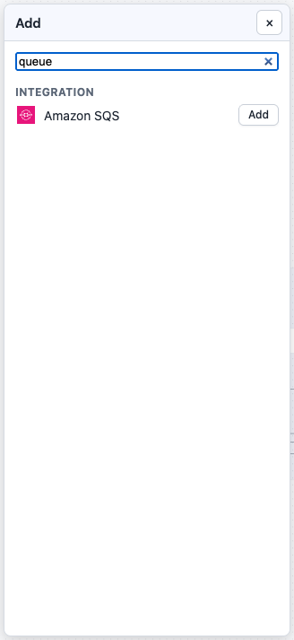
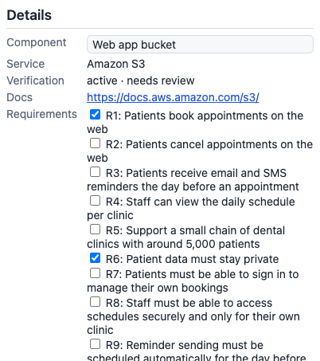
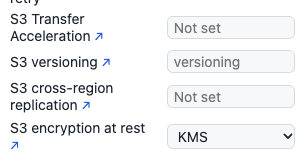
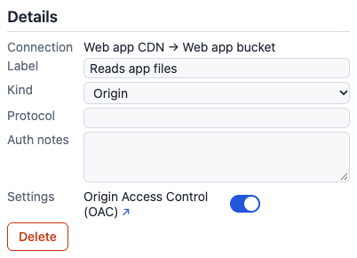

# Edit by hand

Every change can be undone with **↶** (⌘Z / Ctrl+Z) and redone with **↷**. Findings update after
each change. A design holds up to 150 components.

## Add components

Open **Add** in the toolbar. Search, or browse the services by category, outside actors (users,
external systems) and containers.

- **Click Add** to place it. With nothing selected, it goes into the nearest free space in view,
  inside the container it lands in. With a container selected, it goes inside that container,
  and a full container grows to make room.
- **Or drag** a row onto the canvas to drop it exactly where you want.

Close **Add** when you are done, to get the canvas back.

## Connect

Drag from a component's right-hand dot to another component's left-hand dot. To move a
connector's end to another component, drag that end.

## Select, move and resize

- Click to select. ⌘-click (Ctrl-click) adds to the selection; Shift-drag on the canvas selects
  with a box.
- Drag to move. Dropping components into a container moves them into it; dragging them out moves
  them out.
- A selected component or container shows handles for resizing. A container cannot be made
  smaller than its contents.

## Details and settings

Select a component to see its details in the side panel: name, service, catalog status,
documentation, requirements and settings.

- **Component:** rename it.
- **Requirements:** tick the requirements this component serves. A requirement no component
  serves is reported (VR-012), and so is a component that serves none (VR-013).
- **Settings** come from the AWS catalog. Each setting has a control, and ↗ opens AWS's
  documentation for it:
  - **a switch** for a setting that is simply on or off (for example Origin Access Control);
  - **a dropdown** for a setting with fixed choices (for example encryption at rest: KMS or
    AWS-managed). **Not set** removes it;
  - **a text field** for a setting that needs detail (for example a dead-letter queue's name).
    Clearing the text removes it.

  Settings clear findings: for example, setting encryption at rest clears VR-008 for that
  component.

Select a connector to edit its label, kind (Invoke, Read, Write, Event, Origin, Other), protocol,
auth notes and the settings of the services at both ends.

## Delete

Press **Delete** in Details (red), or press Delete or Backspace on the canvas. Deleting a
component also deletes its connectors. Deleting a container keeps what is inside it: its contents move
up to the container around it. Undo brings everything back.

## Auto layout

**Auto layout** in the toolbar arranges the whole diagram and its connectors again. Moving things
by hand keeps your positions.
