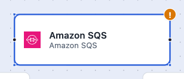
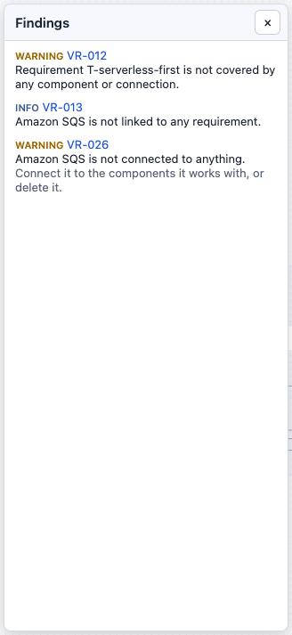

# Findings and rules

After every generation and every edit, 26 fixed rules (not the AI) check the design. Each problem
they find is a **finding**:

- **error:** the design is wrong as drawn (for example a database outside a VPC);
- **warning:** probably a mistake, or a gap against what you asked for;
- **info:** worth a look, often a detail the design does not state.

## Markers on components

A component with findings has a marker on its top-right corner, coloured by its worst finding:
red **!** for an error, amber **!** for a warning, blue **i** for info. Hover over it to read the
findings. Click it to open the Findings window with that component's findings highlighted.

## The Findings window

**Findings (n)** in the toolbar opens the full list. Click a finding's rule id (for example
VR-008) to select the component it is about; the canvas pans to it if a window covers it.

Most findings are fixed in [Details](04-edit-by-hand.md#details-and-settings): set a setting,
link a requirement, connect a component, or move it into the right container.

## The rules

Rules marked _with a priority_ apply only when that [design priority](02-generate.md) was
switched on for the generation.

| Rule   | Level   | What it checks                                                                                        |
| ------ | ------- | ----------------------------------------------------------------------------------------------------- |
| VR-001 | warning | An S3 bucket behind CloudFront without Origin Access Control                                          |
| VR-002 | warning | Clients read S3 directly while CloudFront serves the same content                                     |
| VR-003 | warning | A public API Gateway or load balancer without a stated way to authenticate                            |
| VR-004 | warning | A queue, topic or event consumer without a dead-letter queue or failure destination                   |
| VR-005 | info    | Lambda connects to RDS or Aurora without RDS Proxy                                                    |
| VR-006 | warning | DAX without a requirement for microsecond reads (it adds cost)                                        |
| VR-007 | info    | Nothing for monitoring (CloudWatch) in the design                                                     |
| VR-008 | info    | A data store without stated encryption at rest                                                        |
| VR-009 | error   | EC2, RDS, Aurora, ElastiCache or EFS outside a VPC                                                    |
| VR-010 | error   | A database or cache in a public subnet                                                                |
| VR-011 | warning | Clients upload to S3 without a stated authorization (presigned URL or Cognito)                        |
| VR-012 | warning | A requirement that no component or connector serves                                                   |
| VR-013 | info    | A component linked to no requirement (monitoring and security services excepted)                      |
| VR-014 | warning | A service AWS has deprecated or retired, or whose status is unknown                                   |
| VR-015 | info    | A component the catalog does not know (shown with a **?** tile)                                       |
| VR-016 | error   | AWS WAF on an HTTP or WebSocket API (WAF supports REST APIs only)                                     |
| VR-017 | warning | A Lambda on-failure destination for an SQS source (use the queue's dead-letter queue)                 |
| VR-018 | warning | A load balancer in a single Availability Zone                                                         |
| VR-019 | warning | Servers (EC2, RDS, ECS, EKS) nobody asked for; with **Serverless-first**                              |
| VR-020 | warning | A data store without backups; with **Backups**                                                        |
| VR-021 | warning | A database or cache without Multi-AZ; with **Disaster recovery: Multi-AZ**                            |
| VR-022 | warning | Fewer than two Regions, or a data store without replication; with **Disaster recovery: Cross-region** |
| VR-023 | warning | VPC resources not in two Availability Zones; with **High availability** or disaster recovery          |
| VR-024 | info    | A cost driver (DAX, NAT Gateway, EC2, EKS) no requirement asks for; with **Cost-optimized**           |
| VR-025 | warning | A public entry point without WAF, or a data store without KMS; with **Security hardening**            |
| VR-026 | warning | A component not connected to anything (monitoring and security services excepted)                     |

After a generation, the AI gets one chance to fix errors and warnings itself. VR-026 is shown in
the editor only and is not sent to the AI.
