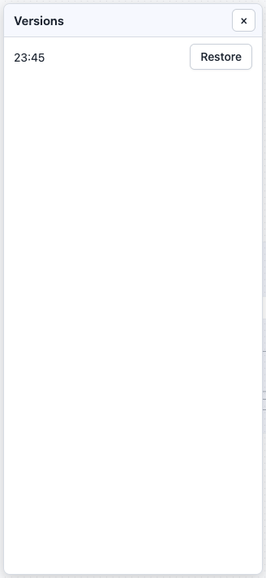
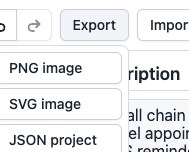

# Versions, import and export

## Where your work is saved

Projects are saved in your browser, on this computer, after every change. Nothing is uploaded.
Export JSON to back a project up or move it to another computer.

## Versions

When a generation or a restore replaces the diagram, the diagram it replaces is kept.
**Versions (n)** in the toolbar lists them, newest first. **Restore** brings one back (and keeps
the current diagram as a version too).

## Export

**Export** in the toolbar offers:

- **PNG image** and **SVG image** of the diagram, for documents and slides;
- **JSON project**: the whole project (diagram, requirements, settings), which you can import
  later.

## Import

**Import JSON** opens a project exported earlier, from this or another computer. Projects from
older versions are upgraded automatically. Import replaces the diagram on screen and does not add
it to Versions, so export the current one first if you want to keep it.
