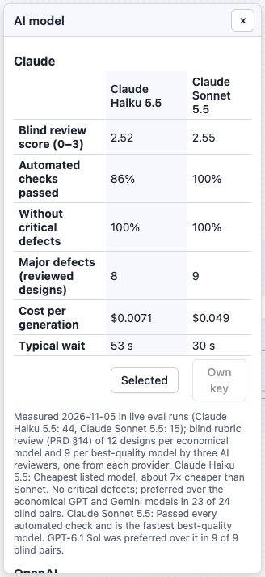

# AI models, limits and privacy

## Choosing a model

**AI model** in the toolbar compares the models setup enabled, per provider: review score, checks
passed, cost per design and typical wait. Press **Use** under a model to generate with it. Models
that setup left off are shown but cannot be chosen.

How the models were measured: [benchmark report](../product/phase3-provider-benchmark.md).

## Spending limits

Setup sets requests per minute and daily and monthly spending limits, counted across all providers
together. When a limit is reached, generation stops with a message; editing, checking and export
keep working. To change the limits, re-run setup
([installation guide](../operations/installation.md#re-running-setup)). Also set a spend limit in
your provider's own console.

## Privacy

- Your API keys stay in the app's Docker volume. They are never logged, never sent to the browser,
  and sent to no one but their own provider.
- Your description, answers and requirements go only to the AI provider you generate with.
- Projects stay in your browser.
- The app has no login and listens only on this computer (`127.0.0.1`). Do not expose it on a
  network without an authenticating proxy in front.
- No accounts, no telemetry.
