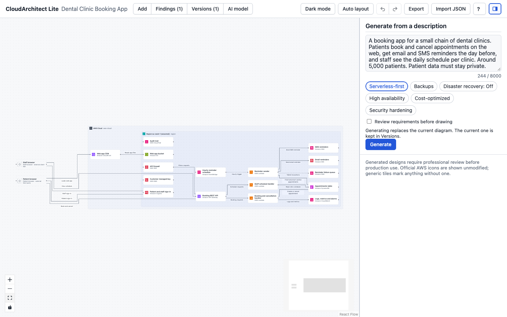

# CloudArchitect Lite user manual

CloudArchitect Lite turns a plain-English description of an application into an AWS architecture
diagram, checks it against 26 rules, and lets you edit and export it. Everything runs on your own
machine with your own AI key.

## Contents

1. [Install and set up](01-install-and-setup.md): Docker, the setup wizard, keys, models and
   spending limits
2. [Generate a design](02-generate.md): describe your application, design priorities, clarifying
   questions
3. [The editor](03-the-editor.md): toolbar, canvas, side panel and tool windows
4. [Edit by hand](04-edit-by-hand.md): add, connect, settings, requirements, containers, delete,
   undo and redo
5. [Findings and rules](05-findings.md): markers, the Findings window, and every rule in plain
   words
6. [Versions, import and export](06-versions-import-export.md)
7. [AI models, limits and privacy](07-models-limits-privacy.md)

**No install?** The [demo](https://aliaksandr-liapin.github.io/cloudarchitect-lite/) runs the
editor in your browser. Everything except generation works there.

**Keyboard shortcuts**

| Action                    | macOS                    | Windows and Linux        |
| ------------------------- | ------------------------ | ------------------------ |
| Undo                      | ⌘Z                       | Ctrl+Z                   |
| Redo                      | ⇧⌘Z                      | Ctrl+Shift+Z or Ctrl+Y   |
| Delete the selection      | Delete or Backspace      | Delete or Backspace      |
| Select several components | ⌘-click                  | Ctrl-click               |
| Select with a box         | Shift-drag on the canvas | Shift-drag on the canvas |

_The screenshots are generated from the running app (`pnpm --filter @cloudarchitect/e2e manual`),
so they match the version of this manual._
