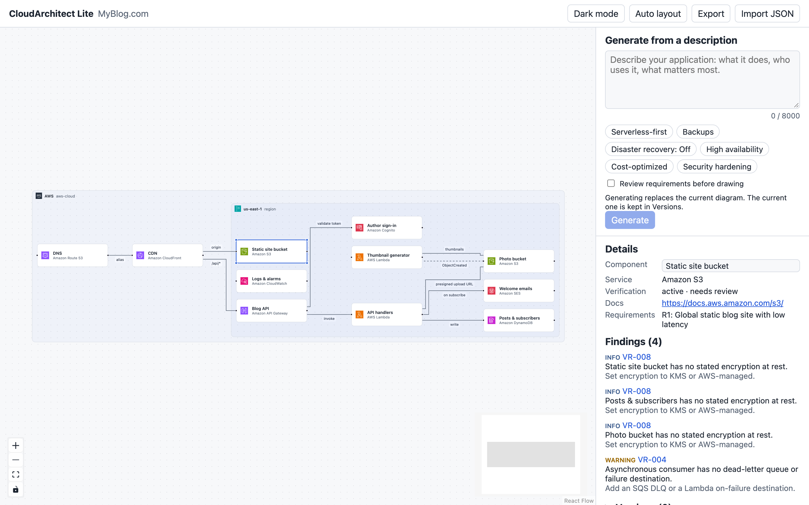
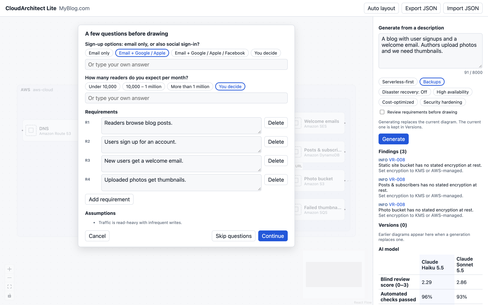

# Installation (self-hosted)

Run CloudArchitect Lite on your own computer or server with Docker. It works the same on Windows, macOS and Linux; only Docker is required.

## 1. Install Docker

| System                         | What to install                                                                                                                   |
| ------------------------------ | --------------------------------------------------------------------------------------------------------------------------------- |
| Windows 10/11                  | [Docker Desktop](https://docs.docker.com/desktop/setup/install/windows-install/) with the WSL 2 backend (the installer offers it) |
| macOS (Intel or Apple silicon) | [Docker Desktop](https://docs.docker.com/desktop/setup/install/mac-install/) or [Rancher Desktop](https://rancherdesktop.io/)     |
| Linux                          | [Docker Engine](https://docs.docker.com/engine/install/) with the Compose plugin                                                  |

Check it works: `docker compose version` should print version 2.24 or newer.

You also need an **Anthropic API key** for AI features: [platform.claude.com → API keys](https://platform.claude.com/settings/keys). Set a monthly spend limit there. Manual editing, validation and export work without a key.

## 2. Install and start

Run one command in an empty folder. It downloads `compose.yaml` and starts the published images; nothing is cloned or built. The terminal stays attached to the app's log; press Ctrl+C to stop, or add `-d` to run it in the background.

**macOS and Linux**

```bash
curl -fsSLO https://raw.githubusercontent.com/aliaksandr-liapin/cloudarchitect-lite/v0.2.1/compose.yaml && docker compose up
```

**Windows (PowerShell)**

```powershell
curl.exe -fsSLO https://raw.githubusercontent.com/aliaksandr-liapin/cloudarchitect-lite/v0.2.1/compose.yaml; docker compose up
```

The images are multi-architecture (Intel/AMD and Arm). Tested on macOS (Apple silicon) and Linux (CI, on every release). Windows (Intel/AMD or Arm) runs the same Linux images through Docker Desktop and is expected to work, but has not been tested by hand yet; please [report](https://github.com/aliaksandr-liapin/cloudarchitect-lite/issues/new?template=bug.yml) what you find. Docker Desktop on Windows needs WSL 2 and virtualization; inside a virtual machine (Parallels, VMware, Hyper-V) nested virtualization must be turned on.

## 3. What you see on first start

When the stack is ready, the terminal shows:

```text
  CloudArchitect Lite is running. Finish setup in your browser:

    http://localhost:8080/setup?code=1a2b3c4d5e6f
```

### About the AWS icons

On first start, CloudArchitect Lite downloads the official AWS icon set from aws.amazon.com so your diagrams look like AWS's own. This step needs internet access; it takes a short moment and the editor shows its progress. Without internet the app still works, with generic tiles instead of AWS icons.

AWS's terms allow these icons for creating architecture diagrams but do not cover redistribution. That is why they are not in the repository or in the images: your own installation fetches them. Each release uses the newest AWS icon set the project has verified. The download is pinned by hash, so every install looks the same and the files cannot be swapped.

## 4. Finish setup in the browser

Open that link. The wizard has five steps.

**1. Welcome.** The setup code from the link proves you can see the server log.


**2. API key.** Paste your key and press **Check key**; Anthropic confirms it before you can continue. If the key comes from a `.env` file, this step only shows that it is set.


**3. Models.** Choose which models the editor can use with your key (Claude Haiku 5.5, Claude Sonnet 5.5) and the default. The table shows the measured quality, cost and speed of each. Models you leave off are shown in the editor but cannot be selected.


**4. Limits.** AI requests per minute, daily and monthly spending limits (defaults: 20 per minute, $5 a day, $50 a month). AI stops when a limit is reached; manual editing keeps working. The wizard estimates how many generations the budget covers.


**5. Review.** Check the summary and press **Finish setup**.


Settings apply immediately and survive restarts. Then press **Open the editor**, or go to <http://localhost:8080>.

## 5. Design your first architecture

The editor opens with a sample diagram, so you can try dragging, resizing, **Auto layout**, the findings list and **Export** right away.



1. Describe your application in **Generate from a description**, for example who uses it, how much traffic you expect and what matters most. Optionally switch on design priorities such as **Serverless-first** or **High availability**.
2. Press **Generate**. The AI asks up to three short questions; pick an answer, type your own, or choose **You decide**. You can also edit the list of requirements before it draws.

   

3. The design appears after about a minute with Claude Haiku (faster with Sonnet). The 25 built-in rules check it; click a finding's rule id (for example VR-008) to select the component it is about. The previous diagram is kept: use **Restore previous** or **Versions**.
4. Edit names and layout by hand, then **Export** a PNG or SVG image, or a JSON project you can **Import** later.

Projects are saved in your browser on this computer. Export JSON to back them up or move them to another machine. **Dark mode** is in the top bar.

## Everyday use

| Task                                  | Command                       |
| ------------------------------------- | ----------------------------- |
| Start in the background               | `docker compose up -d`        |
| Stop                                  | `docker compose down`         |
| See the log (and the setup link)      | `docker compose logs gateway` |
| Upgrade to a newer version            | See [Upgrading](#upgrading)   |
| Remove everything, including settings | `docker compose down -v`      |

## Upgrading

Run these commands **in the same folder** as the original install. Docker names the `gateway-data` volume after the folder, so a new, empty folder starts over with a fresh setup. Set the version you upgrade to, download its `compose.yaml`, then pull and restart:

**macOS and Linux**

```bash
cd path/to/your/install/folder
VERSION=0.2.1   # the version you upgrade to
curl -fsSLO "https://raw.githubusercontent.com/aliaksandr-liapin/cloudarchitect-lite/v$VERSION/compose.yaml"
docker compose pull && docker compose up -d
```

**Windows (PowerShell)**

```powershell
cd path\to\your\install\folder
$Version = '0.2.1'   # the version you upgrade to
curl.exe -fsSLO "https://raw.githubusercontent.com/aliaksandr-liapin/cloudarchitect-lite/v$Version/compose.yaml"
docker compose pull; docker compose up -d
```

Settings and downloaded icons live in the `gateway-data` volume and are kept. To pin a version without editing the file, set `CLOUDARCHITECT_VERSION` (for example in `.env` or the shell).

## Re-running setup

```bash
docker compose exec gateway node node.js reset-setup
docker compose restart gateway
docker compose logs gateway   # open the new setup link
```

The wizard starts from your current values; the API key and the client salt are kept unless you enter a new key.

## Presetting or locking values

Values in a `.env` file override the wizard; the wizard shows which ones are locked. Copy `.env.example` to `.env` and uncomment only what you want to fix, for example `ANTHROPIC_API_KEY` for automated installs. Set `SETUP_WIZARD=disabled` to configure only through `.env`.

## Troubleshooting

| Problem                          | Fix                                                                                                                                                                                                |
| -------------------------------- | -------------------------------------------------------------------------------------------------------------------------------------------------------------------------------------------------- |
| Port 8080 is in use              | Add `WEB_PORT=8081` to `.env`, run `docker compose up -d`, open <http://localhost:8081>                                                                                                            |
| Lost the setup link              | `docker compose logs gateway`; the code changes on every gateway restart                                                                                                                           |
| "The setup code is wrong"        | Use the link from the latest log; restarting creates a new code                                                                                                                                    |
| "Could not reach Anthropic"      | Check the internet connection or proxy of the machine running Docker                                                                                                                               |
| Behind an HTTP(S) proxy          | Add `HTTPS_PROXY=http://proxy.example:3128` (and `NO_PROXY` if needed) to `.env`, then `docker compose up -d`; the gateway image sets `NODE_USE_ENV_PROXY=1`, so its downloads and AI calls use it |
| AWS icons do not appear          | They need internet on first start. Once online, press **Retry** in the editor's icon notice, or run `docker compose restart gateway`                                                               |
| Docker does not start on Windows | Turn on WSL 2 (`wsl --install` in an administrator PowerShell, then restart). In a virtual machine, turn on nested virtualization in its settings first                                            |

## Security notes

- The app has **no login**. Ports are bound to `127.0.0.1`, so only this computer can reach it. Do not publish it on a network without an authenticating reverse proxy in front.
- The API key is stored in `/data/settings.json` inside the `gateway-data` volume, readable only by the gateway user, and never logged or sent back to the browser.
- See [SECURITY.md](../../SECURITY.md) to report vulnerabilities.
