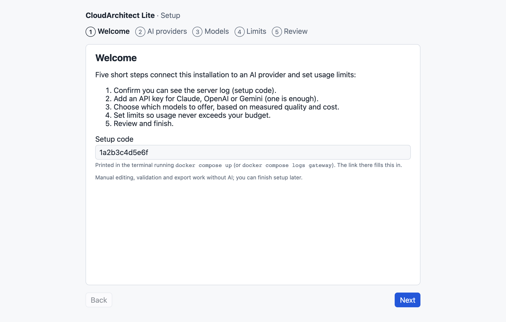
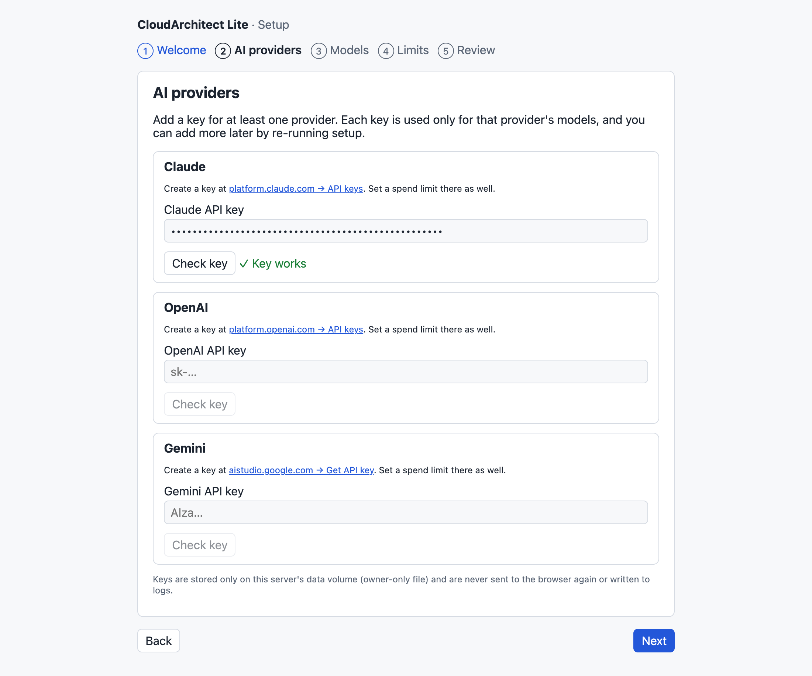
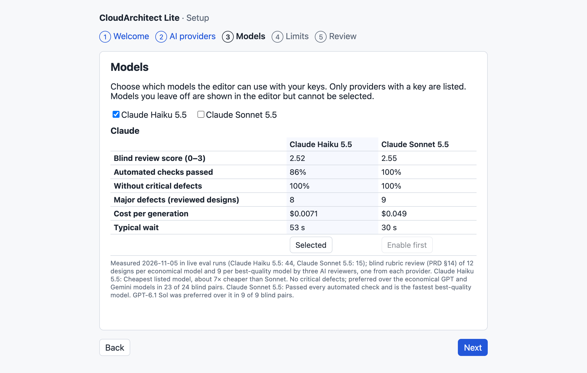
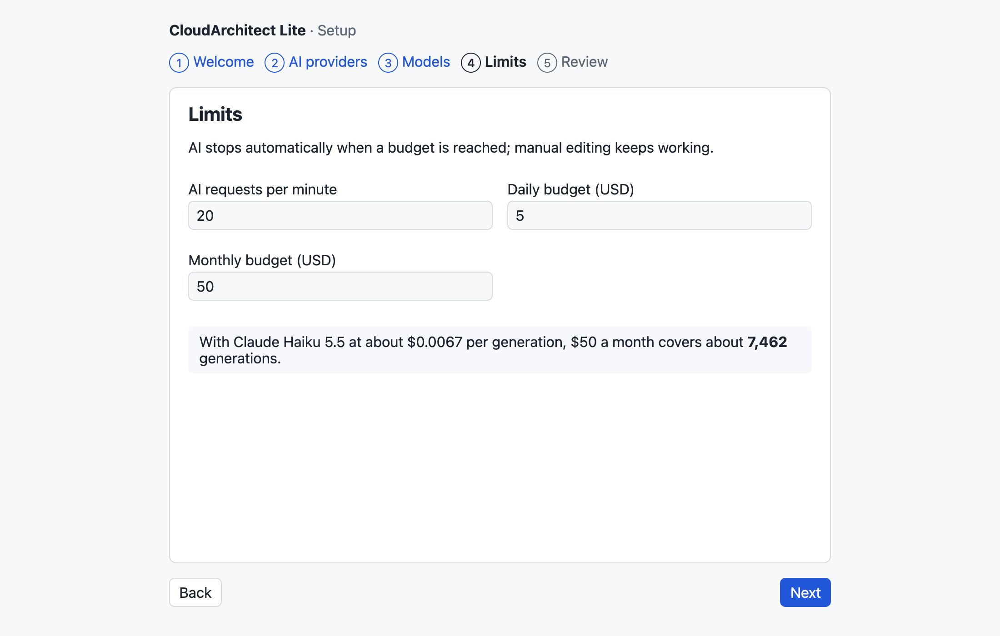
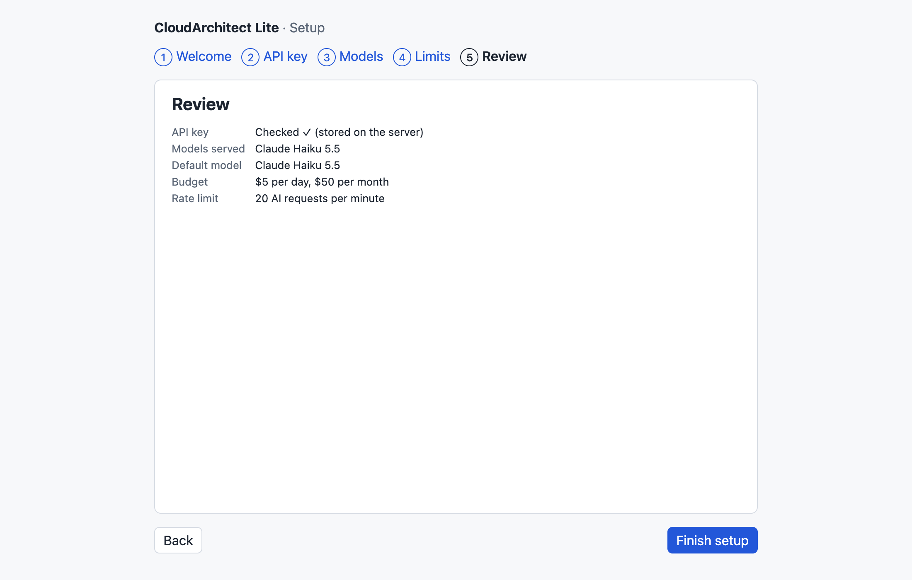

# Installation (self-hosted)

Run CloudArchitect Lite on your own computer or server with Docker. It works the same on Windows, macOS and Linux; only Docker is required.

## 1. Install Docker

| System                         | What to install                                                                                                                   |
| ------------------------------ | --------------------------------------------------------------------------------------------------------------------------------- |
| Windows 10/11                  | [Docker Desktop](https://docs.docker.com/desktop/setup/install/windows-install/) with the WSL 2 backend (the installer offers it) |
| macOS (Intel or Apple silicon) | [Docker Desktop](https://docs.docker.com/desktop/setup/install/mac-install/) or [Rancher Desktop](https://rancherdesktop.io/)     |
| Linux                          | [Docker Engine](https://docs.docker.com/engine/install/) with the Compose plugin                                                  |

Check it works: `docker compose version` should print version 2.24 or newer.

You also need an **Anthropic API key** for AI features: [console.anthropic.com → API keys](https://console.anthropic.com/settings/keys). Set a monthly spend limit there. Manual editing, validation and export work without a key.

## 2. Get the code

```bash
git clone https://github.com/aliaksandr-liapin/cloudarchitect-lite.git
cd cloudarchitect-lite
```

## 3. Start

```bash
docker compose up --build
```

The first build takes a few minutes. When it is ready, the terminal shows:

```text
  CloudArchitect Lite is running. Finish setup in your browser:

    http://localhost:8080/setup?code=1a2b3c4d5e6f
```

## 4. Finish setup in the browser

Open that link. The wizard has five steps.

**1. Welcome.** The setup code from the link proves you can see the server log.



**2. API key.** Paste your key and press **Check key**; Anthropic confirms it before you can continue.



**3. Models.** Choose which models your key serves (Claude Haiku 5.5, Claude Sonnet 5.5) and the default. The table shows the measured quality, cost and speed of each.



**4. Limits.** Requests per minute, daily and monthly spending limits. The wizard estimates how many generations the budget covers.



**5. Review.** Check the summary and press **Finish setup**.



Settings apply immediately and survive restarts. Then use the editor at <http://localhost:8080>.

## Everyday use

| Task                                  | Command                                    |
| ------------------------------------- | ------------------------------------------ |
| Start in the background               | `docker compose up -d`                     |
| Stop                                  | `docker compose down`                      |
| See the log (and the setup link)      | `docker compose logs gateway`              |
| Update to the latest version          | `git pull && docker compose up -d --build` |
| Remove everything, including settings | `docker compose down -v`                   |

## Re-running setup

```bash
docker compose exec gateway node node.js reset-setup
docker compose restart gateway
docker compose logs gateway   # open the new setup link
```

The wizard starts from your current values; the API key and the client salt are kept unless you enter a new key.

## Presetting or locking values

Values in a `.env` file override the wizard; the wizard shows which ones are locked. Copy `.env.example` to `.env` and uncomment only what you want to fix, for example `ANTHROPIC_API_KEY` for automated installs. Set `SETUP_WIZARD=disabled` to configure only through `.env`.

## Troubleshooting

| Problem                                   | Fix                                                                                                |
| ----------------------------------------- | -------------------------------------------------------------------------------------------------- |
| Port 8080 is in use                       | Add `WEB_PORT=8081` to `.env`, run `docker compose up -d`, open <http://localhost:8081>            |
| Lost the setup link                       | `docker compose logs gateway`; the code changes on every gateway restart                           |
| "The setup code is wrong"                 | Use the link from the latest log; restarting creates a new code                                    |
| "Could not reach Anthropic"               | Check the internet connection or proxy of the machine running Docker                               |
| Windows: build fails on scripts or config | Re-clone after `git config --global core.autocrlf false`; the repository already forces LF endings |
| Apple silicon                             | Supported natively (arm64 images are built locally)                                                |

## Security notes

- The app has **no login**. Ports are bound to `127.0.0.1`, so only this computer can reach it. Do not publish it on a network without an authenticating reverse proxy in front.
- The API key is stored in `/data/settings.json` inside the `gateway-data` volume, readable only by the gateway user, and never logged or sent back to the browser.
- See [SECURITY.md](../../SECURITY.md) to report vulnerabilities.
