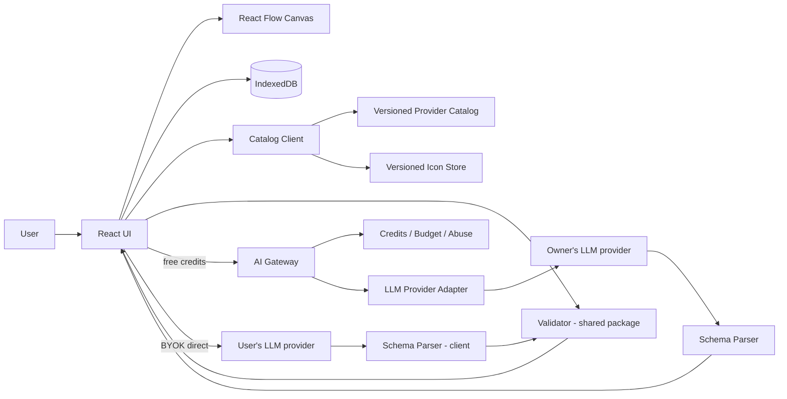

# Technical Architecture — CloudArchitect Lite

**Version:** 0.2 · **Date:** 2026-10-13 · **Status:** target design, pending spikes and security review · **Aligned with:** PRD v0.2

## 1. Architecture principles

- **Local-first** manual experience; no mandatory login/cloud persistence.
- **Graph is source of truth**, not PNG/Mermaid/image output.
- Provider-neutral domain IDs; provider-specific metadata and validators.
- Separate visual assets, cloud facts and AI output.
- Untrusted AI output → schema parse → normalize → validate → render.
- **Validation runs on the client** from a shared TypeScript package, so it works offline, in BYOK mode and without the gateway.
- **Rule findings and advisory AI findings are separate classes** and never displayed as the same thing.
- No secrets in static JS bundle, analytics or application logs.

## 2. Proposed stack

| Layer | Preferred implementation | Notes |
|---|---|---|
| Web | React + TypeScript + Vite | static application |
| Canvas | @xyflow/react (React Flow) | editable nodes/edges; containers as parent nodes (`parentId`) |
| Layout | ELK.js | layered layout with `hierarchyHandling: INCLUDE_CHILDREN` for nested containers; preserve manually set positions |
| Local data | IndexedDB | project persistence and drafts |
| Shared domain package | TypeScript + Zod | project schema, patch ops, validation rules; used by client and gateway |
| Free-AI gateway | Cloudflare Workers (candidate) | owner keys protected on server |
| Credit ledger + budget | D1 or durable transactional store | authoritative counts and spend; KV alone not safe for atomic decrements |
| Abuse controls | Turnstile + rate limits + global budget cap | privacy-sensitive, configurable, kill switch |
| LLM | Adapter interface | Anthropic, OpenAI; OpenRouter (P1); Ollama later. Same adapter used by gateway and by browser BYOK |
| Icons | Versioned asset store | official packs only (PRD §12), lazy-loaded, hashed |
| Exporters | SVG/PNG from canvas; JSON; Mermaid (P1); draw.io (P1) | all support containers |
| Eval harness | Node script in CI | benchmark prompts, metrics, regression gate (§13) |
| Hosting | Static hosting / Cloudflare Pages candidate | minimal operations |

Infrastructure choice is **proposal**, not locked vendor commitment.

## 3. Runtime modules



In free mode the gateway parses and schema-checks the response before returning it; the client always re-runs full validation. In BYOK mode the whole pipeline runs in the browser.

## 4. Data contracts

Stable project schema example (illustrative subset):

```json
{
  "schemaVersion": "1.1.0",
  "projectId": "project-demo",
  "name": "MyBlog.com",
  "revision": 12,
  "providerContext": ["aws"],
  "catalogSnapshot": {"aws": "aws-catalog-2026.10.0"},
  "iconPackSnapshot": {"aws": "aws-icons-2026-07-31"},
  "requirements": [
    {"id": "FR-001", "text": "Send welcome email", "type": "functional", "status": "confirmed"}
  ],
  "containers": [
    {"id": "cloud-1", "kind": "aws-cloud", "label": "AWS"},
    {"id": "region-1", "kind": "region", "parentId": "cloud-1", "label": "us-east-1"}
  ],
  "nodes": [
    {"id": "ses-1", "provider": "aws", "serviceId": "aws.ses", "containerId": "region-1",
     "label": "Welcome emails", "requirementIds": ["FR-001"], "position": {"x": 300, "y": 250}},
    {"id": "ext-1", "provider": "aws", "unresolved": {"name": "Amazon Rekognition", "rationale": "Photo moderation requirement"},
     "containerId": "region-1", "label": "Image moderation", "requirementIds": [], "position": {"x": 500, "y": 250}}
  ],
  "edges": [
    {"id": "e-1", "source": "cf-1", "target": "s3-1", "kind": "origin",
     "configuration": {"originAccess": "OAC"}, "requirementIds": []}
  ],
  "findings": []
}
```

**Container** (new): id, kind (`aws-cloud` / `region` / `vpc` / `availability-zone` / `subnet` / `group`), parentId, label, properties (subnet: `public` | `private`, optional cidr), position, size. Allowed nesting: aws-cloud → region → vpc → availability-zone → subnet; `group` may appear at any level. Global services (CloudFront, Route 53, IAM) attach to `aws-cloud`, not a region.  
**Node**: id, provider, either `serviceId` (from catalog) **or** `unresolved {name, rationale}` (PRD FR-020), label, purpose, rationale, requirementIds, configuration (catalog-defined feature keys such as `transferAcceleration`), containerId, position, metadata provenance.  
**Edge**: id, source, target, kind (invoke/read/write/event/origin/other), protocol, configuration (e.g. `originAccess: OAC`, `authorizer: cognito`), auth notes, label, requirementIds. Direction is source → target; bidirectional semantics use two edges.  
**Requirement**: id, text, type, status (`confirmed` / `inferred` / `open`), provenance.  
**Finding**: id, class (`rule` | `advisory`), ruleId (rule only), severity (`error` / `warning` / `info`), nodeIds/edgeIds/containerIds, explanation, evidence (doc URLs), remediation, validator or model version.

Graph uses stable resource IDs, never icon file names as the primary key. Service catalog version and project schema version are independent. Schema 1.0.0 → 1.1.0 migration: wrap existing nodes in a default `aws-cloud` container; rename `warnings` → `findings`.

## 5. AI pipeline

Operations (1 credit each, PRD §6): **Generate**, **Edit**, **Review**, **Ask** (P1).

**Generate**
1. Prompt → extract structured requirements, assumptions and open questions.
2. If critical open questions exist → return them with an `operationId`; the user answers or skips; continuation uses the same `operationId` and no new credit (max one round).
3. Retrieve the catalog subset relevant to the requirements (services, features, integration patterns) to keep input tokens bounded.
4. Generate architecture JSON with structured output; `serviceId` is an enum of the retrieved subset; anything else must use `unresolved`.
5. Parse and schema-validate; on schema failure retry once with the error, then fail without charging.
6. Client: run the rule set (§10), layout with ELK, render findings.

**Edit** — returns a patch (§8) against `baseRevision`; preview + confirm.  
**Review** — input: current graph + requirements + catalog subset; output: advisory findings only. Never mutates the graph.  
**Ask** — input: question + selected element context + catalog facts/doc links; output: answer with cited documentation URLs.

A single orchestrated request can implement Generate stages during PoC, but preserve interfaces to split later. **Do not** treat LLM claims or confidence as verification of technical correctness. Each operation records token usage and model ID (no prompt content) for the cost model (PRD §7).

## 6. Gateway / API proposal

| Method | Route | Purpose |
|---|---|---|
| POST | `/api/ai/generate` | create draft graph from text + catalog version; may return clarification questions + `operationId` |
| POST | `/api/ai/generate/continue` | continue an operation with clarification answers (no new credit) |
| POST | `/api/ai/edit` | return graph patch and rationale; confirmation on client |
| POST | `/api/ai/review` | return advisory findings for the current graph |
| POST | `/api/ai/ask` | P1 — answer a question about the design with cited sources |
| GET | `/api/catalog/manifest` | current provider manifest / version URLs (can be static) |
| GET | `/api/credits/status` | remaining free credits + `freeAiAvailable` (false when kill switch is active) |

- Reject oversized inputs: prompt ≤ 8 000 characters; graph ≤ 150 nodes.
- Per-request input/output token ceilings, per-session throttles, idempotency key, max parallel jobs per session, upstream timeouts.
- **Budget control:** each operation's cost is added to daily and monthly spend counters atomically; when a cap is reached the kill switch disables free AI and `/api/credits/status` reports it. Manual mode is unaffected.
- Credits are charged only after a successful response; server/provider failures are not charged.
- Cache only safe, non-private assets; never cache user prompts.
- Use provider settings that exclude training on data and minimize retention.

## 7. BYOK — design

**Never publish application owner API keys in frontend.**

**Primary: direct browser calls** to providers that officially support them (as of 2026-10-13: Anthropic via its browser-access header, OpenAI). The user's key never reaches our servers.
- Key held **in memory only** by default; persisting to browser storage is an explicit opt-in with a warning.
- Prompt templates and catalog subsets are loaded by the client; parsing and validation run in the browser using the shared package.
- CSP restricts `connect-src` to our origin plus the supported provider API hosts; no third-party scripts on pages that hold the key.
- The key is never sent to analytics, error reporting or logs (scrubbing enforced in the error reporter).

**Fallback: ephemeral proxy** for providers without browser access — key passed per request, never stored or logged, not cached. Requires a written threat model before release.

**P1: OpenRouter via OAuth PKCE** so users can connect without copying a raw key.

Provider browser support can change; the adapter declares `supportsBrowserDirect` per provider and the UI only offers supported options.

## 8. Manual edit & AI edit coexistence

- Each graph mutation creates a local undo/redo transaction and increments `revision`.
- AI edits produce a proposed patch against `baseRevision`. Ops: `addNode`, `removeNode`, `updateNode`, `addEdge`, `removeEdge`, `updateEdge`, `addContainer`, `removeContainer`, `updateContainer`, `moveToContainer`.
- Preview diff, validate patch, apply only after confirmation.
- Reject stale patches when project revision changed; never overwrite manual positions by default.

## 9. Export & offline

- Serialize normalized JSON with versions and references; schema migration on import.
- SVG/PNG generated from the editable canvas, including containers; test dimensions, fonts, labels, clipping and nested-container borders.
- Mermaid (P1): flowchart with `subgraph` per container.
- draw.io (P1): containers as draw.io container shapes.
- IndexedDB drafts; explicit JSON backup reminder because browser storage may be deleted.
- Offline manual editing after app/assets cache is populated; AI requires remote or local model.

## 10. Validation layers

1. **Structural:** schema, IDs, dangling edges, duplicate IDs, valid container nesting, node in ≤ 1 container.
2. **Catalog:** known service, icon mapping, lifecycle/status freshness, unresolved nodes.
3. **Semantic rules:** VR-001…VR-015 (PRD §11) — deterministic, versioned, each with positive and negative fixtures.
4. **Advisory AI review:** class `advisory`, shown separately, never labelled verified.

Rules are declared as data in `catalog/aws/validation-rules.json` (id, severity, description, docs URL) with the check logic in the shared package keyed by rule ID.

## 11. Security, privacy, legal checklist

- CSP, safe SVG rendering/sanitization of icon assets, dependency scanning, input validation.
- No prompt content in analytics or logs by default; document third-party AI transmission in the Privacy Policy.
- Privacy Policy and Terms of Use published before public beta; GDPR lawful basis documented (PRD NFR-010).
- Credit ledger and budget counters use atomic/transactional changes; anti-abuse is best-effort without identity; the global budget cap is the hard limit.
- Icon packs used only under the source terms recorded in PRD §12; manifest stores source URL, release ID and SHA-256.
- Explicit disclaimers: generated designs require professional review before production deployment.

## 12. Performance targets

- Canvas interaction smooth at ≤ 150 nodes and ≤ 10 nesting levels.
- ELK layout ≤ 2 s for 50 nodes; run in a Web Worker so the UI does not freeze.
- Icons lazy-loaded per service on first use.

## 13. Evaluation harness

- `eval/` contains benchmark prompts, labelled expected requirements, expected rule hits and expected services per scenario.
- CI job runs on changes to prompts, model configuration or catalog: schema validity, requirement recall, expected rule hits, unresolved rate, token usage; compares to the last baseline and fails on regression beyond thresholds.
- Rubric scoring (PRD §14) is done by the independent reviewer in an isolated session (PRD §15), not by CI.

## 14. ADRs

- ADR-001: Graph JSON as canonical model (accepted).
- ADR-002: AWS-first provider-neutral registry (accepted).
- ADR-003: Hybrid 3-free + BYOK (accepted direction; limit adjustable after cost measurement).
- ADR-004: Cloudflare Workers + D1 (proposed, validate during PoC).
- ADR-005: React Flow + ELK.js (proposed preferred implementation; containers spike in Phase 1).
- ADR-006: BYOK via direct browser calls, proxy as fallback (accepted in PRD v0.2; threat model pending).
- ADR-007: Containers as first-class model entities, not nodes (accepted in PRD v0.2).
- ADR-008: Rule findings vs advisory findings as separate classes (accepted in PRD v0.2).
- ADR-009: Automated eval harness as release gate (accepted in PRD v0.2).
