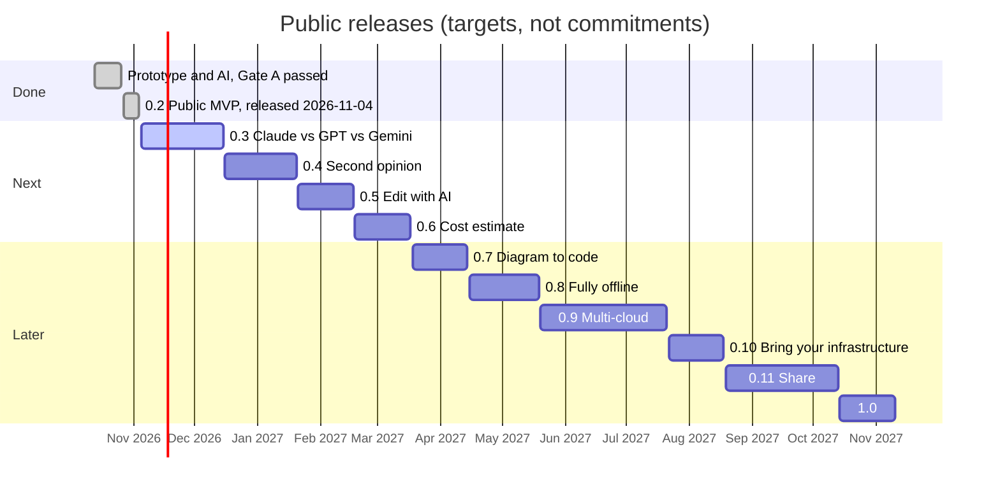

# Roadmap & Implementation Backlog — CloudArchitect Lite

**Version:** 0.4 · **Date:** 2026-11-04 · **Dates:** estimates, not commitments · **Aligned with:** PRD v0.2

## 1. Delivery model

- **Implementation:** Claude, with the product owner making decisions and providing accounts (AI provider, GitHub, domain). Cloudflare was dropped 2026-10-26.
- **Independent architecture review:** Claude in an isolated, blind reviewer session using the PRD §14 rubric (PRD §15).
- The schedule holds only if scope stays at P0; each P1 pulled into MVP moves dates.

## 2. Public release roadmap (from 2026-10-26)

On 2026-10-26 the product owner re-scoped the project. CloudArchitect Lite is a **free, open-source,
self-hosted** tool: each user brings their own AI key, so nothing costs the maintainer to run. It is
also a public showcase built in the open. The project ships in small public releases, about one every
four weeks, each with its own hook, a LinkedIn post and a dev.to article
([dev.to/aliaksandrliapin](https://dev.to/aliaksandrliapin)). Building-in-public posts (design
decisions, ADRs, eval numbers, bug stories) fill the weeks between releases.

**Now:** 0.2.1 is out (released 2026-11-04). Next: 0.3, Claude vs GPT vs Gemini.

Each bar is one release: a design, a plan, a pull request, a GitHub release and an announcement. Details per release are in the table below.

This replaces stages 3–5 below (MVP engineering, private beta, public beta). The hosted-service work
they assumed is dropped (anonymous free credits, an owner budget cap and kill switch, BYOK direct browser calls,
hosted Privacy Policy and Terms).

| Release | Target | Theme | Scope | Announcement hook / article |
|---|---|---|---|---|
| 0.2 | ✅ 2026-11-04 | **Public MVP** (released: 0.2.0, 0.2.1) | Repository public; README with demo GIF; clickable editor demo on GitHub Pages; one-command install (tested on macOS and Linux; Windows expected to work, not hand-tested yet); PNG/SVG/JSON export; hosted-only leftovers dropped (free credits, kill switch, Cloudflare deploy) | "Describe your app, get an AWS architecture checked against 25 rules, on your own key" · How the catalog stops an LLM from inventing cloud services |
| 0.3 | mid-Dec 2026 | **Claude vs GPT vs Gemini** (next) | Claude, OpenAI and Gemini, two models each; public blind benchmark with a three-provider review panel ([design](../superpowers/specs/2026-10-26-multi-provider-ai-design.md)) | "Three AIs designed the same systems: here is who won" · Benchmarking LLMs on architecture design |
| 0.4 | Jan 2027 | **Second opinion** | Review (FR-021): AI critique of any diagram; Mermaid export | "Your diagram, reviewed by AI, rendered in your README" · Rule checks vs AI review |
| 0.5 | Feb 2027 | **Edit with AI** | AI edit of the existing diagram ("add a cache in front of the database"); undo/redo | Diff-based AI editing of a graph |
| 0.6 | Mar 2027 | **Cost estimate** | Monthly AWS cost estimate per diagram from traffic assumptions | "What will this architecture cost?" |
| 0.7 | Apr 2027 | **Diagram to code** | CloudFormation / Terraform skeleton export | "From a sentence to deployable infrastructure" |
| 0.8 | May 2027 | **Fully offline** | Local models via Ollama; benchmark update | "Free, private, no API key" |
| 0.9 | Jun–Jul 2027 | **Multi-cloud** | Azure and GCP catalogs and generation | "Same app, three clouds, side by side" |
| 0.10 | Aug 2027 | **Bring your infrastructure** | Import Terraform/CloudFormation into a diagram, then review it | "Understand inherited infrastructure in a minute" |
| 0.11 | Sep–Oct 2027 | **Share** | Share by link, draw.io export, Ask about the design (FR-022); Hacktoberfest contributor push | Contributing to an open-source AI tool |
| 1.0 | Nov 2027 | **1.0** | Stability, accessibility, documentation site, contribution guide for catalog entries | A year of building in public |

Launch channels for 0.2: LinkedIn, dev.to, Show HN; for 0.3 also r/aws and r/LocalLLaMA. Each
release gets its own design, plan and PR; dates are targets, and July and October carry slack.

## 3. Development stages (original plan, 2026-10-13)

| Phase | Estimate | Outcome | Exit criterion |
|---|---|---|---|
| 0. Discovery / Benchmark | Week 1 | 10–15 reference prompts with labels, rubric, project schema 1.1 (incl. containers), icon packs downloaded and terms recorded, **AI quality spike** (one-shot generation on the benchmark), **token/cost measurement** | Benchmark + rubric ready; spike shows schema-valid output and acceptable recall; cost per operation measured; budget cap decided |
| 1. Visual PoC | Weeks 2–3 | React Flow canvas, **nested containers + ELK layout spike**, official AWS icons, JSON roundtrip, undo/redo | Editable, saveable diagram with containers, no AI dependency |
| 2. AI PoC | Weeks 3–4 | Requirements extraction, clarification round, catalog retrieval, constrained generation, unresolved nodes, rule set VR-001…018, **eval harness in CI** | Gate A — **passed 2026-10-18** (Haiku blind median 2.29, no critical defect in 11/12, live gate green; [report](phase2-gate-a.md)) |
| 3. MVP engineering | Weeks 5–7 | Gateway, Review, exports (dropped 2026-10-26: credits, budget cap + kill switch, BYOK direct browser, Privacy Policy / Terms) | End-to-end workflow; Gate B |
| 4. Private beta | Weeks 8–9 | 15–30 testers, full benchmark blind review, bug fixes | Meaningful user acceptance and reliable core |
| 5. Public beta | ~Weeks 9–10+ | Release, analytics, user feedback | Usage, cost and reliability monitored |

The AI spike is moved into Phase 0 because generation quality is the main product hypothesis; the canvas is lower risk. Original 3–5/4–6 week estimates refer to an aggressive small-scope prototype; the schedule above is the conservative plan.

## 4. Implementation epics

**E1 — Project/Canvas:** editor, graph schema 1.1, **containers (FR-019)**, manual operations, undo/redo, ELK layout in a Web Worker, local save/load, schema migration. Readability pass done 2026-10-19 after Gate A manual testing: orthogonal routing with label space, fit to view, resizable components and groups (schema 1.4.0), light/dark switch, resizable side panel, generation status. Still open: undo/redo, ELK in a Web Worker.

**E2 — Cloud Catalog:** ~40 AWS services + containers + features, CloudFormation-checked IDs, lifecycle, evidence, icon pack import with hashes and terms, manual update checklist, provider-neutral interfaces, sample Azure/GCP schemas.

**E3 — AI Generation:** requirements extraction, clarification round (FR-025), catalog retrieval, structured generation with service enum, unresolved nodes (FR-020), error handling, **eval harness (NFR-013)**.

**E4 — Knowledge & Validation UX:** node/edge/container details, requirement traceability, docs links, rule engine VR-001…025, finding display, **Review (FR-021)**.

**E5 — AI gateway:** gateway/secrets, provider adapters, spending limits (NFR-009), rate limits. dropped 2026-10-26: 3 anonymous free operations, kill switch, credit transparency, BYOK direct browser with proxy fallback, anti-abuse.

**E8 — Self-hosted install (new):** one-command `docker compose up`, browser setup wizard (FR-027), installation guide for Windows/macOS/Linux, model choice with benchmark (FR-026). Done 2026-10-14.

**E6 — Export & QA:** PNG/SVG/JSON with containers; Mermaid and draw.io (P1); graph/icon rendering tests, browser QA, accessibility baseline, performance targets (NFR-012).

**E7 — Legal & compliance (new):** icon attribution and terms, AI provider data notice in the README, disclaimers. Dropped 2026-10-26: hosted Privacy Policy, Terms of Use, GDPR basis.

## 5. Priority order

P0: E1 editor + containers → E2 AWS catalog/icons → E3 structured generation + eval harness → E4 details/rules/Review → E5 gateway and spending limits (credits and BYOK dropped 2026-10-26) → E6 core export → E7 legal.  
P1: AI edit with preview, Ask (FR-022), Mermaid export, draw.io export, OpenRouter OAuth, advanced traceability, manual Architecture Freshness Check.  
P2: Cost estimate, architecture alternatives, ADR/report export, IaC, Azure/GCP generation, automated catalog pipeline, collaboration.

## 6. Product differentiation to test

- Faster **time to accepted diagram** vs manual/editor-plus-chatbot workflow and vs existing text-to-diagram tools.
- Official consistent iconography and trustworthy supported service IDs.
- Clear connection descriptions, requirement coverage and rule-based findings.
- No signup; a manual editor that is free; a simple setup wizard for the user's own key.

## 7. Beta metrics (proposed targets)

- Valid graph output ≥ 99% on curated benchmark.
- Key requirements recall ≥ 90% on benchmark.
- Median rubric score ≥ 2.0 / 3 and no critical defect in ≥ 90% of scenarios (blind review).
- No unsupported service ID accepted as officially verified.
- MyBlog: welcome email traced to SES; DAX not generated without a justifying requirement; manually added DAX flagged by VR-006 and Review.
- Measured cost per operation shown to the user; spending limits tested (the kill switch was dropped 2026-10-26).
- Zero secrets in app bundle/logs; the AI key never reaches the browser (BYOK direct mode and quota-bypass controls dropped 2026-10-26).
- Manual canvas and exports usable when AI gateway is unavailable.

## 8. Decision gates

- **Gate A (after AI PoC):** blind review of ≥ 10 distinct reference scenarios against the rubric — diagram fidelity, correct edges and containers, no critical defects; eval harness green.
- **Gate B (before private beta; replaced 2026-10-26 by the 0.2 release checklist):** icon terms recorded for every pack and usage within those terms; security test of keys and spending limits; disaster recovery of local project via JSON export. (Privacy Policy and Terms dropped.)
- **Gate C (after beta):** empirical time saved, retention, real generation cost vs budget, willingness to pay; compare reviewer scores with beta user feedback to detect reviewer blind spots.

## 9. Risks and mitigations

| Risk | Mitigation |
|---|---|
| ~~Free AI abuse and unexpected costs~~ (dropped 2026-10-26) | Was: global budget cap, kill switch, Turnstile. Now the user's own key plus daily/monthly spending limits and capped tokens |
| Generation quality below targets | AI spike in Phase 0, eval harness in CI, catalog subset retrieval, clarification round |
| Hallucinated cloud knowledge | Curated sourced catalog + structured enum + unresolved status + rule validation |
| Nested container layout complexity | Phase 1 spike with ELK hierarchical layout; fallback to manual container sizing |
| Icon trademark/licensing breach | Only the three official sources; terms recorded per pack; icons never committed or in images, fetched on first start; no use in branding |
| ~~BYOK key exposure~~ (dropped 2026-10-26) | Was: direct browser mode, memory-only key, proxy threat model. Now the key stays in the user's own gateway; CSP `connect-src 'self'`; log scrubbing |
| ~~Provider drops browser-direct support~~ (dropped 2026-10-26) | The browser no longer calls providers |
| Reviewer shares blind spots with generator | Doc-cited findings, optional human spot-check, compare with beta feedback (Gate C) |
| Model drift | Regression benchmark gates every model/prompt change |
| Browser storage loss | Export/backup with migration metadata and UI reminder |
| Scope creep to multi-cloud | AWS feature complete first; generic adapters now, provider content later |
| Crowded market | Focus on validation/traceability differentiation; measure against competitors at Gate C |

## 10. Future vision (not committed)

- V1.5: architecture alternatives, cost assumptions/estimates, ADR.
- V2: architecture-to-backlog, controlled Terraform/CDK template generation.
- V3: full Azure/GCP content and capability-based multi-cloud comparisons.
- V4: read-only cloud inventory, design-vs-actual drift and continuous architecture review.
