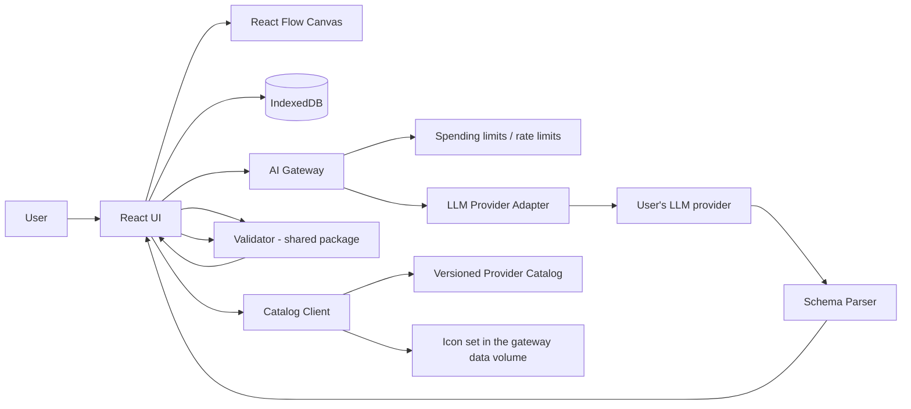

# Technical Architecture — CloudArchitect Lite

**Version:** 0.3 · **Date:** 2026-10-27 · **Status:** design; updated 2026-10-27 for self-hosted only ([ADR-0013](../adr/0013-self-hosted-only.md)) · **Aligned with:** PRD v0.2

## 1. Architecture principles

- **Local-first** manual experience; no mandatory login/cloud persistence.
- **Graph is source of truth**, not PNG/Mermaid/image output.
- Provider-neutral domain IDs; provider-specific metadata and validators.
- Separate visual assets, cloud facts and AI output.
- Untrusted AI output → schema parse → normalize → validate → render.
- **Validation runs on the client** from a shared TypeScript package, so it works offline and without the gateway.
- **Rule findings and advisory AI findings are separate classes** and never displayed as the same thing.
- No secrets in static JS bundle, analytics or application logs.

## 2. Proposed stack

| Layer | Preferred implementation | Notes |
|---|---|---|
| Web | React + TypeScript + Vite | static application |
| Canvas | @xyflow/react (React Flow) | editable nodes/edges; containers as parent nodes (`parentId`) |
| Layout | ELK.js | layered layout with `hierarchyHandling: INCLUDE_CHILDREN` for nested containers; preserve manually set positions |
| Local data | IndexedDB | project persistence and drafts |
| Shared domain package | TypeScript + Zod | project schema, patch ops, validation rules; used by client and gateway |
| AI gateway | Node (Hono) in a Docker container | the only runtime; holds the user's own AI key; dropped 2026-10-26: Cloudflare Workers + D1 |
| Spending limits | Daily and monthly spend counters in the gateway | protect the user's own key; rate limits per client |
| LLM | Adapter interface | Anthropic now; OpenAI and Gemini in 0.3; Ollama later. The adapter runs in the gateway only |
| Icons | Official AWS pack pinned by SHA-256 (`packages/catalog/data/icon-packs.json`) | fetched by the gateway on first start, only mapped SVGs kept in its data volume; never committed or in images; generic tiles if unavailable (catalog spec §9) |
| Exporters | SVG/PNG from canvas; JSON; Mermaid (P1); draw.io (P1) | all support containers |
| Eval harness | Node script in CI | benchmark prompts, metrics, regression gate (§13) |
| Hosting | `web` and `gateway` images on the user's machine; static demo on GitHub Pages | no hosted service |

Self-hosted only is a decision ([ADR-0013](../adr/0013-self-hosted-only.md)); the original hosted plan (Cloudflare, free credits, browser BYOK) is dropped 2026-10-26.

## 3. Runtime modules



The gateway parses and schema-checks the response before returning it; the client always re-runs full validation. The browser never calls an AI provider.

## 4. Data contracts

Stable project schema example (illustrative subset):

```json
{
  "schemaVersion": "1.4.0",
  "projectId": "project-demo",
  "name": "MyBlog.com",
  "revision": 12,
  "providerContext": ["aws"],
  "catalogSnapshot": {"aws": "aws-catalog-2026.10.0"},
  "iconPackSnapshot": {"aws": "aws-icons-2026-07-31"},
  "requirements": [
    {"id": "FR-001", "text": "Send welcome email", "type": "functional", "status": "confirmed"}
  ],
  "containers": [
    {"id": "cloud-1", "kind": "aws-cloud", "label": "AWS"},
    {"id": "region-1", "kind": "region", "parentId": "cloud-1", "label": "us-east-1"}
  ],
  "nodes": [
    {"id": "ses-1", "provider": "aws", "serviceId": "aws.ses", "containerId": "region-1",
     "label": "Welcome emails", "requirementIds": ["FR-001"], "position": {"x": 300, "y": 250}},
    {"id": "ext-1", "provider": "aws", "unresolved": {"name": "Amazon Rekognition", "rationale": "Photo moderation requirement"},
     "containerId": "region-1", "label": "Image moderation", "requirementIds": [], "position": {"x": 500, "y": 250}}
  ],
  "edges": [
    {"id": "e-1", "source": "cf-1", "target": "s3-1", "kind": "origin",
     "configuration": {"originAccess": "OAC"}, "requirementIds": []}
  ],
  "findings": []
}
```

**Container** (new): id, kind (`aws-cloud` / `region` / `vpc` / `availability-zone` / `subnet` / `group`), parentId, label, properties (subnet: `public` | `private`, optional cidr), position, size. Allowed nesting: aws-cloud → region → vpc → availability-zone → subnet; `group` may appear at any level. Global services (CloudFront, Route 53, IAM) attach to `aws-cloud`, not a region.  
**Node**: id, provider, either `serviceId` (from catalog) **or** `unresolved {name, rationale}` (PRD FR-020), label, purpose, rationale, requirementIds, configuration (catalog-defined feature keys such as `transferAcceleration`), containerId, position, optional size (1.4.0), metadata provenance.  
**Edge**: id, source, target, kind (invoke/read/write/event/origin/other), protocol, configuration (e.g. `originAccess: OAC`, `authorizer: cognito`), auth notes, label, requirementIds. Direction is source → target; bidirectional semantics use two edges.  
**Requirement**: id, text, type, status (`confirmed` / `inferred` / `open`), provenance.  
**Finding**: id, class (`rule` | `advisory`), ruleId (rule only), severity (`error` / `warning` / `info`), nodeIds/edgeIds/containerIds, explanation, evidence (doc URLs), remediation, validator or model version.

Graph uses stable resource IDs, never icon file names as the primary key. Service catalog version and project schema version are independent. Schema 1.0.0 → 1.1.0 migration: wrap existing nodes in a default `aws-cloud` container; rename `warnings` → `findings`. Later steps only add optional data: 1.2.0 external nodes, 1.3.0 `generation` metadata and the `toggle` provenance, 1.4.0 node `size`.

## 5. AI pipeline

Operations (PRD §6): **Generate**, **Edit**, **Review**, **Ask** (P1).

**Generate**
1. Prompt → extract structured requirements, assumptions and open questions. Extraction always runs `claude-haiku-5-5`.
2. If open questions exist (at most 3, topics from the fixed `GapTopic` list) or the user asked to review requirements → return them with an `operationId` and a signed `operationToken`; no credit is charged. The user answers (or picks "You decide"), may edit the requirements, and calls `/continue` once (max one round).
3. Generate architecture JSON with structured output (`output_config.format`) against the catalog contract with the selected model; anything outside the catalog must use `unresolved`. Haiku gets one repair turn with the deterministic validator's findings.
4. Parse and schema-validate; a schema failure fails the operation.
5. Client: run the rule set (§10), layout with ELK, render findings.

**Edit** — returns a patch (§8) against `baseRevision`; preview + confirm.  
**Review** — input: current graph + requirements + catalog subset; output: advisory findings only. Never mutates the graph.  
**Ask** — input: question + selected element context + catalog facts/doc links; output: answer with cited documentation URLs.

A single orchestrated request can implement Generate stages during PoC, but preserve interfaces to split later. **Do not** treat LLM claims or confidence as verification of technical correctness. Each operation records token usage and model ID (no prompt content) for the cost model (PRD §7).

## 6. Gateway / API proposal

| Method | Route | Purpose |
|---|---|---|
| POST | `/api/ai/generate` | create draft graph from text + catalog version; may return clarification questions + `operationId` |
| POST | `/api/ai/generate/continue` | continue an operation with clarification answers and edited requirements (one operation) |
| POST | `/api/ai/edit` | return graph patch and rationale; confirmation on client |
| POST | `/api/ai/review` | return advisory findings for the current graph |
| POST | `/api/ai/ask` | P1 — answer a question about the design with cited sources |
| GET | `/api/catalog/manifest` | current provider manifest / version URLs (can be static) |
| GET | `/api/models` | model options and measured benchmark (ADR-0011) |

**Generate contract** (schemas in `packages/domain/src/ai.ts`):

- `POST /api/ai/generate` takes `GenerateRequest` `{ prompt, catalogVersion, model?, toggles, reviewRequirements }` and returns `GenerateResponse`: either `{ status: 'questions', operationId, operationToken, requirements, assumptions, questions }` or `{ status: 'done', project, usage: { costUsd } }`.
- `POST /api/ai/generate/continue` takes `ContinueRequest` `{ operationId, operationToken, answers, requirements? }` and returns the `done` shape. Edited requirements (1–100, unique ids, text 1–2 000 characters) replace the extracted ones; a requirement whose text changed, or whose id is new, gets `provenance: 'user'`.
- Errors, in check order: `400 invalid_request`, `503 setup_required` (no key configured), `403 model_not_enabled`, `503 ai_unavailable` (a spending limit is reached), `409 catalog_mismatch` (generate only, `catalogVersion` differs from the served catalog); on continue, `400 invalid_operation` and `410 operation_expired` come before the model and spending-limit checks. Model failures: `502 generation_failed` (schema-invalid output) and `502 provider_error` (any provider error).

**Operation token.** The server is stateless between the two calls: the token is `base64url(JSON state) + '.' + base64url(HMAC-SHA256)` with the secret `operation-token:<CLIENT_KEY_SALT>`. The state holds the operation id, the client key, model, toggles, prompt, project name, extracted requirements, assumptions and questions, and an expiry 15 minutes out. `/continue` rejects a token that fails the signature or the state check, or whose `clientKey` or `operationId` does not match the caller and the body (`400 invalid_operation`), and an expired one (`410 operation_expired`), before any model call. The token is signed, not encrypted; it only goes back to the client that wrote the prompt.

**Spend rules.**

- Every completed model call is priced and added to the daily and monthly spend counters straight away, including calls of failed, aborted and question-only operations.
- A schema failure fails the operation. `/continue` re-checks the model and the spending limits. (Dropped 2026-10-26: per-operation credits, `402 no_credits`.)
- Each AI request logs one event `{ requestId, event: 'ai_generate' | 'ai_continue', model, calls, inputTokens, outputTokens, costMicroUsd, outcome }` and nothing else (NFR-006).

- Reject oversized inputs: prompt ≤ 8 000 characters; graph ≤ 150 nodes.
- Per-request input/output token ceilings, per-session throttles, idempotency key, max parallel jobs per session, upstream timeouts.
- **Budget control:** each operation's cost is added to daily and monthly spend counters atomically; when a limit is reached, AI routes return `503 ai_unavailable` until the period rolls over. Manual mode is unaffected. (The manual kill switch was dropped 2026-10-26.)
- Cache only safe, non-private assets; never cache user prompts.
- Use provider settings that exclude training on data and minimize retention.

## 7. AI key handling

**Never publish API keys in the frontend.** Each user runs their own gateway with their own key ([ADR-0013](../adr/0013-self-hosted-only.md)).

- The key is entered in the setup wizard or set in the container environment; it rests on the host's Docker volume (mode 0600) and is sent only to the AI provider by the gateway. The browser never holds it.
- CSP `connect-src` is `'self'`; the browser talks only to the web origin, which proxies `/api` to the gateway.
- The key is never sent to analytics, error reporting or logs.
- Dropped 2026-10-26: BYOK direct browser calls, the ephemeral proxy fallback and OpenRouter OAuth PKCE (all were part of the hosted plan).

## 8. Manual edit & AI edit coexistence

- Each graph mutation creates a local undo/redo transaction and increments `revision`.
- AI edits produce a proposed patch against `baseRevision`. Ops: `addNode`, `removeNode`, `updateNode`, `addEdge`, `removeEdge`, `updateEdge`, `addContainer`, `removeContainer`, `updateContainer`, `moveToContainer`.
- Preview diff, validate patch, apply only after confirmation.
- Reject stale patches when project revision changed; never overwrite manual positions by default.

## 9. Export & offline

- Serialize normalized JSON with versions and references; schema migration on import.
- SVG/PNG generated from the editable canvas, including containers; test dimensions, fonts, labels, clipping and nested-container borders.
- Mermaid (P1): flowchart with `subgraph` per container.
- draw.io (P1): containers as draw.io container shapes.
- IndexedDB drafts; explicit JSON backup reminder because browser storage may be deleted.
- Offline manual editing after app/assets cache is populated; AI requires remote or local model.

## 10. Validation layers

1. **Structural:** schema, IDs, dangling edges, duplicate IDs, valid container nesting, node in ≤ 1 container.
2. **Catalog:** known service, icon mapping, lifecycle/status freshness, unresolved nodes.
3. **Semantic rules:** VR-001…VR-018 (PRD §11) — deterministic, versioned, each with positive and negative fixtures.
4. **Advisory AI review:** class `advisory`, shown separately, never labelled verified.

Rules are declared as data in `catalog/aws/validation-rules.json` (id, severity, description, docs URL) with the check logic in the shared package keyed by rule ID.

## 11. Security, privacy, legal checklist

- CSP, safe SVG rendering/sanitization of icon assets, dependency scanning, input validation.
- No prompt content in analytics or logs by default; document third-party AI transmission in the Privacy Policy.
- No hosted service, accounts or telemetry, so no hosted Privacy Policy or Terms (dropped 2026-10-26); the README states what leaves the machine.
- Spend counters are updated after every completed model call; the spending limits are the hard limit.
- Icon packs used only under the source terms recorded in PRD §12; manifest stores source URL, release ID and SHA-256.
- Explicit disclaimers: generated designs require professional review before production deployment.

## 12. Performance targets

- Canvas interaction smooth at ≤ 150 nodes and ≤ 10 nesting levels.
- ELK layout ≤ 2 s for 50 nodes; run in a Web Worker so the UI does not freeze.
- Icons served from the gateway's data volume and cached by the browser.

## 13. Evaluation harness

- `eval/` contains benchmark prompts, labelled expected requirements, expected rule hits and expected services per scenario.
- CI job runs on changes to prompts, model configuration or catalog: schema validity, requirement recall, expected rule hits, unresolved rate, token usage; compares to the last baseline and fails on regression beyond thresholds.
- Rubric scoring (PRD §14) is done by the independent reviewer in an isolated session (PRD §15), not by CI.

## 14. ADRs

- ADR-001: Graph JSON as canonical model (accepted).
- ADR-002: AWS-first provider-neutral registry (accepted).
- ADR-003: Hybrid 3-free + BYOK (superseded by ADR-013, dropped 2026-10-26).
- ADR-004: Cloudflare Workers + D1 (superseded by ADR-013, dropped 2026-10-26).
- ADR-005: React Flow + ELK.js (proposed preferred implementation; containers spike in Phase 1).
- ADR-006: BYOK via direct browser calls, proxy as fallback (superseded by ADR-013, dropped 2026-10-26).
- ADR-007: Containers as first-class model entities, not nodes (accepted in PRD v0.2).
- ADR-008: Rule findings vs advisory findings as separate classes (accepted in PRD v0.2).
- ADR-009: Automated eval harness as release gate (accepted in PRD v0.2).
- ADR-013: Self-hosted only (accepted 2026-10-26).
